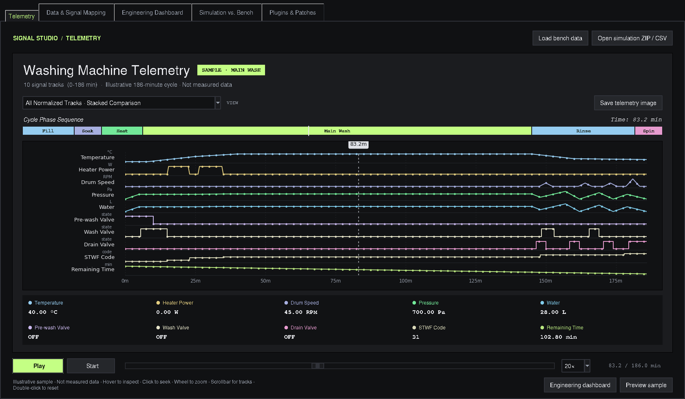

# Appliance Signal Studio — Qt Data Workbench

The default app is a PySide6/PyQtGraph workbench. The original Tk application is
retained intact in `app_legacy.py`, including calibration, plugins, presets and
legacy exports. Existing imports through `main` continue to work.

```sh
python3.12 -m venv .venv
.venv/bin/python -m pip install --only-binary=:all: -r requirements-build.txt
.venv/bin/python main.py           # Modern workbench
.venv/bin/python main.py --legacy  # Original Tk application
```

The modern window opens maximized and supports compact windows down to 1024×680.
Engineering Dashboard is tab 0, Comparison tab 1, and Telemetry tab 2. Use View to
show or hide dock panels. Double-click channels or drag selected channels from
Data Portal onto a workspace to plot them. Different units have independent axes;
Channel → Assign axis also permits separate axes for channels with the same unit.

- Import CSV/text, Excel, ZIP-contained CSV, Parquet and JSON tables. Choose the
  coordinate column and numeric clock unit during import. Automatic detection uses
  seconds unless the column explicitly names minutes. Original source tables are
  separate from sorted numerical projections; duplicate timestamps remain intact.
- Filter channels by text or regex, edit metadata, duplicate/delete, move between
  groups/datasets, merge groups, reorder, and control bulk visibility in the active
  workspace. Select an original dataset in Channel Table to inspect source cells.
- Choose Single, Horizontal split, Vertical split, 2×2 or Stacked plotting layouts.
  Hidden panes retain their bindings when layouts shrink. Compatible coordinates
  link pan/zoom and cursors; temporal and frequency panes remain separate.
- Click to position cursor A, Shift-click for B. Choose snapped or free positions,
  point or dual mode. Readout and Interval Measurements show original-sample values
  and covered-span Mean/RMS, coverage, extrema, slope and integral.
- Ctrl+M opens Channel Math. Use formulas such as `Ch("Power") * 0.001`,
  `Ch("T_out") - Ch("T_in")` or `convert(Ch("Power"), "kW")`. Ambiguous names
  require the channel's stable ID. Combining channels requires identical clocks;
  conversions check physical dimensions.
- Preview and Apply moving average, Savitzky–Golay, Butterworth low-pass, scale/offset,
  time shift, resampling, calculus, descriptive statistics, histogram, FFT, Welch
  PSD, and peak/valley detection. Applied results are ordinary derived channels
  with parent IDs and recorded recipes. Define local unit scales in Channel Math.
- Channel → Marker, Threshold or ROI annotates the active pane. Thresholds use
  the selected plotted channel's axis. Mask interval uses the dual cursors; masks
  affect numerical projections, processing, readouts and processed exports.
- Properties contains explicit warning/fault bounds. Without configured bounds,
  badges say Unconfigured; limits never invent acceptance criteria. OS theme changes
  follow System mode. Toolbar/badge tooltips wait 2.5 seconds.
- Save workspace writes a JSON manifest and a generation-named adjacent NPZ. Keep
  both together. Restoration keeps channel arrays, original tables, view bindings,
  ranges, cursors, annotations, selected channels, source selector, local units and
  dock state. Ctrl+P exports independent raster/vector presentations. Export data
  writes selected processed channels to CSV or Excel, including statistic labels
  and per-metric units.
- Engineering Controls reuses the established alignment/comparison pipeline.
  Original-recording scorecards retain their legacy source interpretation; generic
  channel masks do not alter them. Legacy calibration/plugins open the retained app.
- Ctrl+K opens commands. With a plot focused, Space enables pan, R fits, and C
  toggles cursors. Preview sample is explicitly synthetic.

See [VALIDATION.md](VALIDATION.md) for newly measured results and limitations and
[FRONTEND_FEATURE_REVIEW.md](FRONTEND_FEATURE_REVIEW.md) for the reconstruction map.
Native Windows packaging remains subject to validation on Windows.

## Retained legacy workflow

## Confirmed Bench Comparison

Extract the entire folder. For Python, install `requirements.txt` and run
`python main.py`. To create a Windows EXE, double-click **build_windows.bat**;
see [BUILD_EXE.md](BUILD_EXE.md). Rebuild an existing EXE to apply these changes.

## Telemetry workspace

The app now opens in a dark telemetry workspace inspired by the supplied video.
Existing data mapping, synchronization, engineering dashboard, dual cursors,
comparison, calibration, plugins, presets and Excel/CSV/image exports remain
available in their original tabs.



- **Open simulation ZIP / CSV** loads a reference directly into telemetry.
- **Load bench data** opens the existing input/channel mapping tools. Render
  Dashboard aligns the recording, prepares the engineering dashboard and opens
  its mapped tracks in Telemetry.
- Choose stacked normalized tracks, thermal, drum, water/valves or controller.
  Normalization applies only to the stacked plot; readouts retain original
  numbers and units. Subsystem plots keep each signal's own numeric axis.
- Hover or click to inspect a time. Play/pause, seek, change playback speed,
  use the wheel to zoom, and double-click the chart to restore its full range.
  The chart scrollbar keeps tracks readable in smaller windows.
- Recorded state/code channels generate the phase strip using observed values.
  No named washing phases are invented for a recording without that information.
- **Preview sample** is an explicitly illustrative 186-minute cycle. Its phase
  names and synthetic values are not measured data and never populate the
  engineering or comparison results. Telemetry images of the sample are labelled
  as illustrative in their metadata.
- **Save telemetry image** exports the visible chart as PNG/PDF. Ctrl+S uses
  image export in Telemetry and the existing Excel export in the analysis tabs.

### Download the Windows app

The [Build Windows application workflow](https://github.com/swarajsuman321-dev/Analizer/actions/workflows/windows-build.yml)
starts on pushes to `main` and can also be run manually from GitHub Actions.
After a successful run, download **ApplianceSignalStudio-Windows** from that
run's Artifacts section and extract it. It contains the single-file EXE and a
portable ZIP. Extract the portable ZIP completely before opening its EXE.
Build logs and self-test reports are retained in a separate diagnostics artifact.
Artifacts are kept for 30 days. GitHub may require you to sign in to download them.
Native Windows builds run the regression suite, including GUI checks, and verify
both packaged executables before upload. See [BUILD_EXE.md](BUILD_EXE.md) for
local Windows builds.

## New PD/RD synchronization option

In **Data Ingestion & Signal Studio → Sync Strategy**, select
**First Drum Start to First Power Rise**, then **Render Dashboard**.
This matches the first observed drum rotation in RD to the first sustained
increase above standby power in PD. It does not require a 1500 W heater spike
or matching source clocks, and does not mean the final high-speed spin.
The other synchronization options and existing default remain available.

Drum detection uses absolute feedback speed above **10 RPM**, after at least
two known standstill samples. `Drump speed feedback` / `Drum speed feedback`
are preferred; motor feedback is excluded. If no drum feedback column was
exported, commanded drum speed can be used with a visible warning. A feedback
column with unknown readings is never silently replaced with command speed.

Power standby is the median of the first three known samples. The rise must
exceed standby by at least **20 W**, or six robust noise standard deviations
when larger. Both events must persist across at least two samples spanning
**0.5 seconds**. Isolated spikes, unknown samples and large sampling gaps do
not confirm a start. Missing channels or events produce a clear error; this
mode does not silently fall back to another alignment strategy.

For the supplied **9 kg IEC load T-1** files, the selected events are:

| Source | Selected event |
| --- | --- |
| RD | Drum feedback reaches 23 RPM at **03-Oct-2026 10:26:08.287** |
| PD | `P-E1` reaches **53.03 W** at exported elapsed time **10 seconds** |

The PD event is shifted to the RD event. The aligned PD recording starts
**2.359 seconds after** the RD recording. This is an event-based alignment
assumption, not proof that the original recordings started together. A single
shift preserves each recording's measured intervals and all signal values;
it does not correct clock drift. Original uploaded files are not changed.

Open **Data Quality & Synchronization** after rendering to review event times,
channels, thresholds, offset and warnings. The first power rise can belong to
a different load, and drum feedback can lag electrical power; inspect the
selected events if either occurs. Synchronization details are also exported.

## Confirmed bench mapping

| Parameter | Simulation source | Bench source |
| --- | --- | --- |
| Temperature | `water_temp` | `Current Temperature` |
| Pressure | Original `water_pressure` numbers, labelled Pa | Original `water  pressure` numbers, labelled Pa; raw sensor channel excluded |
| Pre-wash valve | `pre_wash_valve_open` | `Inlet Valve` |
| Main-wash valve | `main_wash_valve_open` | `out Vavle` |
| Cumulative inlet water | `water_amount` in litres | Requires a cumulative litres channel; absent in the supplied bench CSV |
| STWF code | `stwf_number` | Requires the actual STWF code; bench `Wash Stage` 1–3 is a different signal |
| Drain | `drain_open` | `Drain Valve` |
| Actual remaining time | Recording end minus elapsed time | Recording end minus elapsed time |
| Drum speed | `drum_speed` | `Drump speed feedback`, preferred over command speed |
| Heater | `heater_power` in W | `Heat Valve` state; 128 and other positive integer values are ON |

Every parameter keeps its own axis and shares the time axis. Missing signals do
not block the remaining comparison. All original rows and extra source columns
remain available in raw Excel export; graph reduction affects plotting only.

## Values and difference colours

The comparison reports simulation value, bench value and signed difference
(**bench minus simulation**). For suitable numeric metrics:

`difference_percent = (bench - simulation) / abs(simulation) * 100`

| Absolute percentage difference | Colour |
| --- | --- |
| Below 10% | Green |
| 10% through 20%, including both boundaries | Yellow |
| Above 20% | Red |

These are display colours, without acceptance limits or PASS/FAIL verdicts.
The magnitude chooses the colour; the sign remains visible. A zero simulation
value has no percentage denominator, so its difference remains available and
its percentage is blank. Unavailable or unverified metrics remain grey.

Pre-wash, main-wash and drain rows show activation counts and count differences
only. Combined inlet bursts use either valve ON and count simultaneous operation
once. ON at the first recording sample counts as an observed activation; its
true earlier start is not known. Unknown states make counts incomplete.

The desktop table and `Scorecard_Summary` Excel sheet use the same colours.
Open **Difference Colours** for the legend.

## Actuator states and heater ON time

For numeric actuator states, **positive integers mean ON and 0 means OFF**.
128 is ON. Negative values, fractional values and missing values stay unknown.
Existing ON/OFF and true/false exports remain supported, including the simulator's
boolean valve fields. Integer-valued numbers such as 1.0 are accepted as integers.

Heater ON time sums each observed ON sample's interval up to the next timestamp.
For the supplied raw bench data, `Heat Valve` is 128 from 08:32:46.885 to
08:38:38.820: **5.865583 minutes**, shown as **5.87 min**. The final timestamp
closes the recording; no interval is added after it. Duplicate timestamps add
zero elapsed time while all state transitions remain available for counts.

Simulation heater watts stay numeric on the left axis, and bench OFF/ON uses the
right axis. Any positive simulation watt value means heating active. Bench watts
are not invented. The cursor compares ON/OFF activity and the workbook includes
`Heater_State_Comparison`. Explicit measured bench W/kW channels remain supported.

## Timing and pressure units

The logger changes sampling cadence during the supplied run. Spin segmentation
and ON-time integration use a gap threshold of five times the 90th percentile
positive sample interval for recordings with at least 20 intervals. Shorter
recordings use five times the median. Unknown states and genuine recording
outages still prevent a complete heating-time result.

Final sustained spin uses absolute speed above 600 RPM for at least 30 seconds
and selects the last qualifying segment. With the supplied feedback data, its
start is **245.903683 min**, shown as **245.90 min**.

Pressure keeps **the original numbers from both files**, with **Pa** as the
requested display label. No pressure multiplication, division, fitted scale or
offset is applied, including when source metadata declares another unit. Source
unit metadata remains available in exports; the display label does not establish
the physical unit. The paired raw sensor channel remains excluded.

The supplied files show simulation peak **863 Pa** versus bench peak **992 Pa**:
**+129 Pa**, **+14.95%**, shown in **yellow**. Both traces share a **0–3000 Pa**
axis, which expands if original values fall outside that range. **Reference Units
/ Calibration** retains time settings; pressure numbers stay unchanged.

CSV time defaults to minutes. ZIP references can use documented precise seconds
counters after checking them against rounded minutes. Standalone CSVs retain
their explicit time column. Both actual countdowns reach zero at their own
recording end; estimated/display countdown fields are unused. Durations reflect
the provided recording boundaries, including any recorded pre-cycle or tail.

## ZIP references and exports

A ZIP needs one `*_simulated_values.csv`. Optional XML, batch and source files
can establish run-specific export definitions. Missing optional files do not
block plotting; multiple result CSVs require separate packages. Source files,
FMUs and MAT artifacts are not executed.

Exports include original bench/simulation data, signal quality, source units,
comparison values, heater states and available package metadata. The PNG
reference digitizer remains a legacy fallback; image calibration must be
confirmed before percentage colours imply verified numeric comparison.

## Verification

The original **54 regression tests** are retained, with **7 additional telemetry tests**.
The complete 61-test suite passed under a Linux virtual display; without a display,
the three GUI tests are explicitly skipped. Native Windows packaging is validated
by the Windows workflow when it runs. They cover drum-start alignment, feedback
selection, noisy readings, brief spikes, unknown states, gaps, missing events,
source-clock differences, command fallback warnings, plugin option refresh,
integer actuator states, raw 128
heater activity, changing cadence, true gaps, feedback preference, mbar/raw
pressure separation, original pressure numbers despite unit metadata, shared
pressure axes, colour boundaries, zero denominators, individual counts,
Excel colours, CSV/ZIP parsing, original samples, cursor values and unit overrides.

The real controller and ten-panel graph were checked with all **55,999 bench
rows** and **143,011 simulation rows**. Source entry self-tests also cover icons,
ZIP parsing, original pressure numbers and Pa labels, RPM feedback, heater 128 timing, plot rendering
and Excel readback, plus first-drum / first-power-rise synchronization. The new
alignment was checked with all **16,979 PD rows** and **60,606 RD rows** from the
9 kg recording (528 duplicate RD timestamps retain the last sample under the
existing dashboard policy). Native Windows GUI and EXE compilation run on the Windows
build computer, not in this Linux environment.

```bat
python -m unittest discover -s tests -v
```
