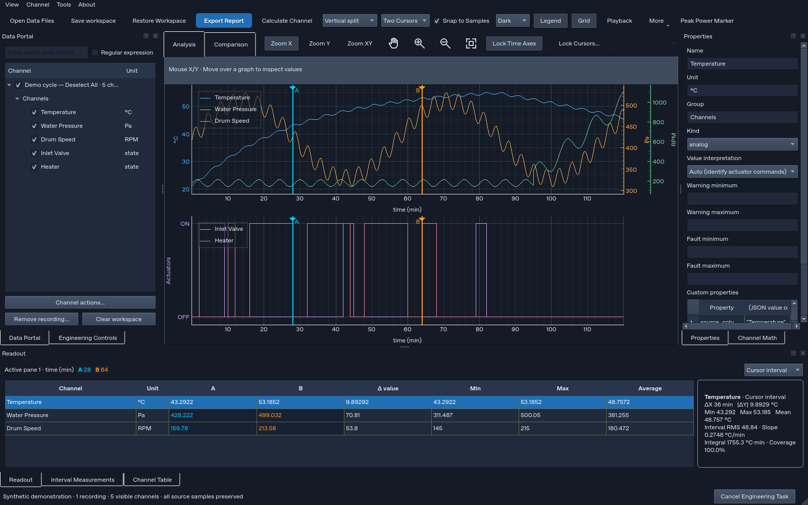

# Appliance Signal Studio 2.3.1

A standalone Qt workbench for recording import, channel analysis and reporting.
Python 3.12 is the supported development runtime.



```sh
python3.12 -m venv .venv
.venv/bin/python -m pip install --only-binary=:all: -r requirements-build.txt
.venv/bin/python main.py
```

On Windows use `.venv\Scripts\python.exe`, or build a portable executable with
`build_windows.bat`. See [BUILD_EXE.md](BUILD_EXE.md).

## Everyday workflow

1. **Open** TDMS, CSV/text, Excel, ZIP-contained CSV, Parquet or JSON recordings. Data
   loads directly into the current Analysis or Comparison workspace. Clocks are
   detected from column names. Unlabelled numeric time is interpreted as seconds,
   then converted to **minutes**, as are seconds, milliseconds, hours and timestamps.
   Recognized simulator exports already in minutes are kept in minutes.
   Axes, cursor intervals, playback and processed reports use minutes; original
   source tables keep their recorded values. Data without a clock remains sample-indexed.
2. Check a channel to plot it; uncheck it to hide its trace. Each file checkbox
   selects or deselects only that file’s channels, including those hidden by its search filter.
   Checks reflect the visible panes of the current workspace. Selecting a tree
   row inspects its properties without changing visibility.
3. Drag cyan **A** and amber **B**, or click / Shift-click the plot. Snap uses real
   coordinates from the first nonempty plotted channel. Other channels report
   their nearest original sample, preserving missing values and each channel's
   sampling rate. Turn Snap off for interpolated analog readouts. Cursor positions
   stay within the visible data extent; inverted cursors are supported with a
   positive ΔX and signed B−A ΔY. Select a readout row for its compact interval card.
4. Click **Export Report** and save a PDF summary, high-resolution PNG, Excel
   workbook or CSV. PDF/PNG include visible traces, independent axes, cursor
   positions and interval statistics. Excel includes original samples inside each
   pane's A/B interval plus a cursor-summary sheet. CSV contains interval samples
   and cursor coordinates. Each channel keeps its own clock; exports do not
   fabricate a shared sampling rate. Missing or masked values stay missing.

Different units use independent Y axes, with tick/label colors matching their
traces. Compatible viewports share panning and cursor coordinates. Time is displayed in **min**. Time and
frequency coordinates use separate panes; frequency analysis retains Hz. R fits the active plot; C toggles
cursors; Space enables panning.

See [FEATURE_PARITY.md](FEATURE_PARITY.md) for the earlier-feature audit and the location
of every restored capability.

**View** controls Engineering Controls, Properties, Channel Math, original
Channel Table and detailed interval statistics. All panels and channel-kind display
are enabled by default; shared dock areas expose tabs. Use Show all panels to restore
this visibility in one click. **Analyze** applies a formula or
numerical operation directly as a derived channel. The advanced capabilities live under **Tools**, including channel styling, playback,
engineering diagnostics, image-reference calibration, presets and extension management.
There is no permanent sample-preview pane or separate legacy application. Save workspace writes a JSON manifest plus an
adjacent generation-named NPZ; keep both together when sharing/restoring.

## Engineering comparison

Engineering Controls aligns power/machine recordings and compares measured
machine data with simulation CSV/ZIP data. The established engine retains source
rows, feedback-channel preferences, raw pressure numbers labelled Pa, positive
integer actuator states (128 is ON), event alignment and missing-data rules.

Verified relative-difference metrics display **match = max(0, 100 − |difference
percent|)**. Match accents use ≥90%, 70–<90%, and <70% bands. Missing, unverified,
or zero-reference metrics remain neutral. These are similarity indicators, not
engineering acceptance limits. Color words are never printed as status values.
The same percentage rules and accents are used in PDF/PNG and Excel reports.

## Validation

```sh
python -m unittest discover -s tests -v
python windows_entry.py --self-test --report self-test.json
python -m pip check
```

Linux GUI tests need an X display (Xorg dummy or Xvfb); Qt-only runs may use
`QT_QPA_PLATFORM=offscreen`. The title bar and Windows EXE properties show **2.1.7**. The Windows build artifact
is **ApplianceSignalStudio-Windows-v2.1.7**. The source and frozen entry share the same Qt
frontend. See [VALIDATION.md](VALIDATION.md) for measured results and limitations.

## Navigation and locked cursors (2.1.1)

The navigation toolbar exposes Zoom X/Y/XY, Pan, Reset zoom and Lock cursors.
**F1** lists shortcuts: Ctrl+1/2/3 selects X/Y/XY rectangle zoom, Ctrl+4 pans,
Ctrl+= / Ctrl+- zooms in/out, Ctrl+0 resets the active plot to its full data range,
and Alt+Left/Right navigates view history. R and Escape work with plot focus.

**Ctrl+L** opens cursor locking. Choose a channel separately for A and B. Each
locked cursor snaps to that channel's real sample clock, keeps its sample index
when panning or shifting the channel, and updates all compatible selected plots
and readouts. Left/Right steps A; Shift+Left/Right steps B. Stepping beyond the
visible range pans the view to the sample. Hiding the anchor channel releases its
lock. Locks persist with the workspace; they can be released in the same dialog.

Normal imports detect bracketed units, bracketed/plain dedicated unit rows,
recognized unit suffixes and known simulator channel names. Explicit units take
priority; unknown units stay blank and can be set under channel appearance.
Original source tables are preserved. Time projections continue to use minutes.

Repeated **Align recordings** refreshes channels by source recording and column.
Unchanged results keep their IDs and do not create duplicates. Appended samples
update existing traces; newly available columns add channels. Channel names,
styles, visibility and cursor anchors remain attached to their existing IDs.

## Equal navigation for every channel (2.1.2)

Vertical pan, wheel zoom, rectangle zoom and zoom buttons move every visible
unit axis together by the same screen proportion. Each axis keeps its own units
and scale; there is no first-channel privilege or extra activation step. X-only
zoom leaves all Y ranges unchanged. Reset zoom refits every axis and keeps locked
cursor anchors. Locked channel names, values, units and timestamps appear directly
in the pinned Readout card in the cursor's cyan or amber color.

The Readout table uses its width for A, B, Δ value, Min, Max and Average columns.
Channel names remain resizable; the selected-channel card includes the locked
A/B readings so users do not need to search the parameter list.

Choose **Cursor interval** or **Whole recording** for Min/Max/Average. Reports
identify that scope; A/B values, differences and CSV/Excel sample exports still
follow the active cursor interval. **Add note** (Ctrl+Shift+N) pins a short event
note to cursor A; notes persist in sessions and appear in plot reports.

## Zoom mode correction (2.1.3)

Zoom X keeps every Y-axis range fixed; Zoom Y keeps the time range fixed. The
selection band spans the disabled dimension, and wheel/zoom buttons respect the
same setting. Zoom XY changes both dimensions.

## Actuator commands and application icon (2.1.4)

Auto interpretation identifies actuator commands by their names and declared
units, rather than treating every numeric channel as a switch. For identified
actuators, zero is OFF and any nonzero integer (including negative integers) is
ON. Missing, infinite and fractional readings remain Unknown. Explicit ON/OFF
and TRUE/FALSE words are also supported. Measured heater watts, valve current,
program stages and fault codes retain numeric meaning.

Properties → Value interpretation provides Auto, Numeric/original readings and
Actuator ON/OFF for exceptions. Choices persist in workspaces and presets, and
survive repeated alignment. Original command values are retained alongside the
normalized states. Binary channels have step traces, OFF/ON axes, readable cursor
states, ON duration and duty over known time. Reports and interval exports retain
the interpretation and original numeric codes; source tables stay unchanged.

The existing app icon is now assigned to the Qt application/window and the
Windows taskbar identity, in addition to being embedded in the executable.

### Updates and the Info tab (2.1.5)

Open **Info** for the offline user manual and select a version. Choose **Check for updates → Download update → Install update & restart** to move to the latest stable GitHub release. The app verifies the SHA-256 checksum, saves a recovery workspace, keeps the previous EXE as a backup and restores your workspace after restarting. Update checks are manual and never upload recordings. Cancellation or a failed download leaves the installed app unchanged. Automatic installation requires the Windows app in a writable folder; source users update their checkout as usual.

The 2.1.4 app needs one manual upgrade to 2.1.5 to gain the updater. Public, non-expiring downloads are published under [GitHub Releases](https://github.com/swarajsuman321-dev/Analizer/releases/latest) only after Windows tests and both frozen-app checks pass. Future releases must increment `app_version.py`, Windows version metadata and the bundled manual. CI creates `update.json` from the exact tested EXE and publishes it with the release; an already published version is immutable.

## TDMS recordings and mouse X/Y hover (2.1.6)

**Open** now accepts `.tdms` directly, including LabSys `dTime / Value / Status` groups and NI waveform channels. Each measurement keeps its own timestamps and sample count; time is displayed in minutes. Declared engineering units, source metadata and quality flags are retained. Invalid-quality points remain unknown. Existing engineering values are not scaled a second time, and metadata expressions are never executed. Undeclared units remain editable in Properties. The reader is bundled: no NI installation is required.

Move the mouse over a plot for a live crosshair, pointer X/Y coordinates on the independent axis scales, and the nearest trace's actual sample time/value/unit. Hovering leaves A/B cursors and their locks unchanged. State traces show ON/OFF; hover guides disappear outside the plot and stay out of saved reports. The reader was checked against the supplied 27-channel recording (305,779 measurements, approximately 232.37 minutes), with source-value comparisons, workspace restoration and PDF/PNG/CSV exports. Uploaded recordings are not included in the repository or executable.

TDMS also works in recording alignment and bench comparison. Those workflows use a derived union of the recorded timestamps, carrying only earlier readings for at most five seconds (the synchronization engine’s existing tolerance). The direct Analysis view keeps the native channel clocks. Alignment retains the untouched TDMS source table separately from this synchronized projection.

## Top-toolbar help and complete manuals (2.1.7)

**Info & manual** is now in the main top toolbar and opens a separate manual/update window. Only Analysis and Comparison remain in the graph-tab area. The offline version selector, topic navigation and Find next search provide a complete feature reference, including every processing operation, View panel, engineering/comparison workflow, export, shortcut, preset and extension facility. Archived manuals include only the features supported by their app version.

Every View panel and Show channel kind start enabled. The first automatic update from a pre-2.1.7 session applies the new visibility default once; later recoveries retain the user's choices. Explicit workspace Restore respects saved layouts. **View → Show all panels** reopens the panels without clearing data.

Maintain the manuals in `manuals/feature-guide.md` (each topic includes its first supported version), add release notes in `scripts/build_manuals.py`, then run `python scripts/build_manuals.py`. Only generated version manuals are bundled in the EXE.

### Current status and future reference

See [application status, user requirements, real-file audit and maintenance reference](docs/APP_STATUS_AND_REFERENCE.md) for the v2.1.9 recording-removal/TDMS-template/output-folder work, reproducible test commands, confirmed fixes, expected data limitations and release verification. Raw uploaded recordings and generated measurement outputs are not stored in this repository.

### Desktop finalization (v2.2.0)

Engineering Controls starts as the selected dock tab. Each file has independent selection/close controls; graph navigation follows the active canvas. About/Updates and the searchable User Manual are separate windows. See [desktop finalization and compatibility/cleanup details](docs/DESKTOP_FINALIZATION.md) and the [v2.2.0 manual](manuals/v2.2.0.md).

### TDMS engineering templates and update restart (v2.2.1)

Engineering Controls now shares Open's first-use TDMS review and persistent templates. The updater starts an independent bundled runtime instead of inheriting the exiting app's temporary extraction path. See [fix details and recovery instructions](docs/TDMS_AND_UPDATE_FIXES.md), the [v2.2.1 manual](manuals/v2.2.1.md), and the [installed Windows application assessment](docs/INSTALLATION_OPTIONS.md).

### Header navigation and non-obstructing hover (v2.2.2)

Zoom X, Zoom Y, Zoom XY, Pan, Reset View and Lock Cursors are in the upper application toolbar. Mouse X/Y readings use a fixed strip outside the canvas. Modes remain visible and persist per workspace. See [layout and verification details](docs/HEADER_NAVIGATION_AND_HOVER.md) and the [v2.2.2 manual](manuals/v2.2.2.md).

### Quick zoom beside the graph tabs (v2.2.3)

The unused right side of the Analysis/Comparison tab row now offers Zoom In, Zoom Out, Reset View, and an X/Y/XY/Pan selector. These reuse the existing actions, maintain synchronized navigation, and keep text and controls outside the graph. See [quick zoom verification](docs/QUICK_ZOOM_CONTROLS.md) and the [v2.2.3 manual](manuals/v2.2.3.md).

The top **About** menu beside **Tools** contains **User Manual** and **Updates**. Same-unit channels, including valves, receive distinct stable colors with matching legends enabled for new workspaces; saved styles and visibility preferences are retained.

Current acceptance review and limits: [v2.2.3 requirements](docs/REQUIREMENTS_REVIEW_V2.2.3.md). Native Windows release verification: [record](docs/validation/release-v2.2.3.json).

## Engineering analytics and compact workbench (v2.3.0)

One primary navigation toolbar, direct Legend/Grid controls, inline playback, adaptive dialogs and per-workspace appearance settings preserve the existing workbench. Engineering Setup provides configurable appliance profiles, reviewed channel mappings/units, run roles, phase rules, calibration and explicit limits. Analyze Engineering Data adds quality-aware KPIs and run comparisons; Generate Engineering Report creates traceable paginated PDF and nine-sheet Excel reports. No manufacturer phase meanings, calibrations or acceptance limits are invented.

Read the [v2.3.0 manual](manuals/v2.3.0.md) before configuring an engineering evaluation. Native Windows release evidence is published only after verification completes.

## UI/UX audit

The [18 October 2026 UI/UX audit](docs/audits/2026-10-18/README.md) includes the usability scorecard, click-budget analysis, layout blueprint, prioritized implementation plan, and supporting evidence. Findings apply to the source commit identified in the report.
