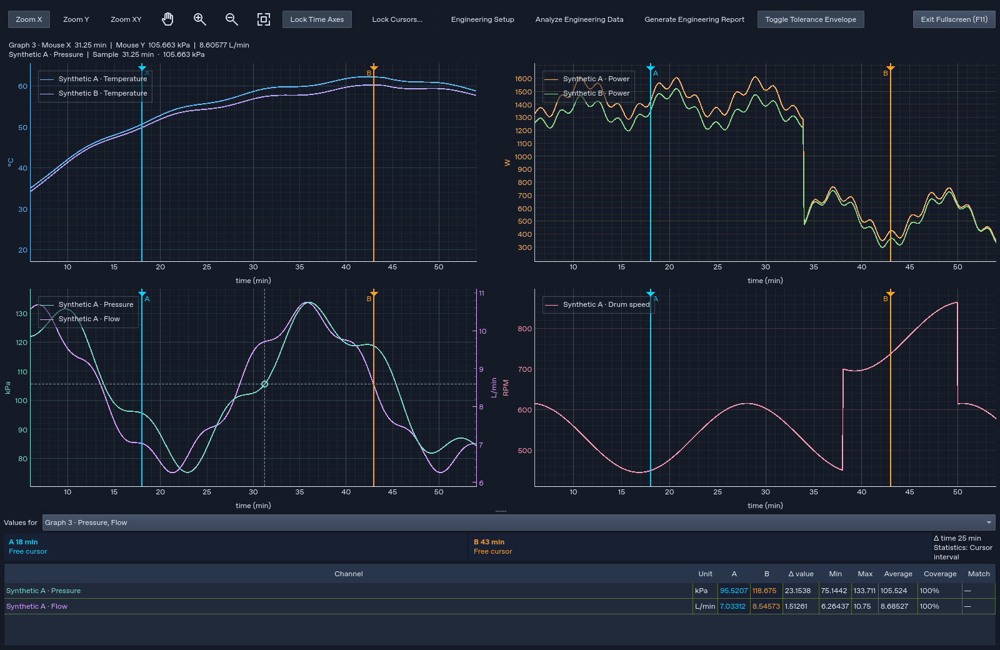

# Appliance Signal Studio 2.4.3 — split-workspace fullscreen and useful comparisons

Published and independently verified 29 October 2026. **Version 2.4.3 is published** for Installed Setup, standalone EXE and standalone ZIP/folder from the same tested source, version, manual and update cycle. See the [downloads](https://github.com/swarajsuman321-dev/Analizer/releases/tag/v2.4.3) and [permanent native/public evidence](validation/release-v2.4.3.json).

## Graph layout and hover stability

- **Fullscreen Workspace (F11)** expands all currently visible graphs in the active Analysis or Comparison split layout. The same panes, traces, independent axes, numerical views and cursor/sample locks remain in use. Shared navigation stays available; the active graph supplies the live cursor/interval readout while the other panes remain visible. Larger stacked layouts retain scrolling rather than forcing unreadable axes.
- **Fullscreen Selected Graph (Shift+F11)** remains available for deliberate single-pane inspection. The previous capability is retained alongside the new default. Esc or the fullscreen exit control returns the graphs to their existing workspace arrangement.
- A stable, font-aware two-line mouse readout prevents the canvas from shifting vertically when hover switches between a placeholder and channel/sample values. The supplied seven-second video showed a small vertical layout shift while numerical X ranges and cursor X positions stayed fixed. The correction targets this demonstrated layout feedback; it must not change source coordinates or introduce a separate zoom engine.
- Stacked graph columns align their actual screen-space drawing edges, including native viewports with different insets or widths. Axis labels remain automatic and numeric time limits stay unchanged. Alignment updates allow a frame for layout events to settle; rounding ignores only sub-pixel floating-point noise. The Windows interaction gate verifies the previously hanging inset regression with the existing half-pixel tolerance.

## Compare Two Signals

The new **Compare Two Signals** action is intended for the direct user task: open two raw recordings, select one parameter from each, compare, and receive understandable results plus report evidence without configuring an appliance profile.

Exactly two selected channel rows form the explicit Reference/Candidate pair; otherwise exactly two plotted channels can form the pair, or a compact source-qualified chooser asks for the two channels. More than two selected channels must not cause an arbitrary pair to be chosen. Both recordings and the chosen parameter identities remain visible in the result.

The user confirmed **elapsed time from each recording's start** as the alignment. A selected channel's late start remains an offset within its recording; the channel's first sample must not silently redefine the recording origin. Alignment creates a comparison view and does not alter original arrays, timestamps, masks or stored plots.

The comparison reports supported overlap/coverage, individual channel statistics, signed and magnitude differences, the largest difference and its time, and applicable activity/timing observations. Difference statistics are time-weighted over supported intervals rather than biased toward the logger with more samples. Mismatched sample rates, missing values, masks, duplicate timestamps and acquisition gaps must remain explicit. Unknown or unsupported spans do not become known zero, OFF state or extrapolated data. Binary-state behavior applies to reviewed actuator interpretation, not every numeric parameter. For declared rotation-unit signals, exact zero/nonzero support and numeric sign changes are descriptive; negative values do not by themselves establish mechanical reversal or the meaning of a protocol code. No manufacturer threshold is invented.

The one-button workflow saves a uniquely named PDF, matching Excel workbook and evidence JSON together, then offers concise results and direct open actions. Detailed difference intervals and events belong in complete evidence; the readable report may summarize them with explicit scope and limitations. No universal pass threshold, calibration curve, phase mapping or automatic engineering acceptance rule is introduced.

## Comparison and engineering report preparation

- **Comparison → Export Report** gains readable paginated PDF sections for source/scope, plots, channel/cursor results and quality/provenance with reviewed notes. All selected visible panes and channel evidence remain represented. PDF publication also saves a matching Excel workbook and evidence JSON as one atomic bundle. Excel retains its interval samples and cursor summary while adding supporting report details and paired comparison evidence where available. Existing PNG snapshots and CSV sample exports keep their distinct purpose.
- Comparison workbooks stream worksheet rows with bounded cell memory, while retaining complete samples, difference intervals, events, numeric precision, literal text, match accents and long notes. Progress and cancellation remain available during row writing; publication still commits the complete bundle together.
- **Generate Engineering Report** retains four main sections, explicit whole-recording/cursor/both scope and complete companion evidence. Comparison rows and per-run cursor evidence continue onto readable pages instead of showing only a few initial rows. The established concise Analysis fixture remains the baseline; additional comparison, cursor and reviewed-note content may increase the page count.
- **Report Details & Conclusions…** provides optional Report title, Prepared by, Reviewed by, Test conditions, Observations, Conclusions and Recommended actions. Shared details are retained in existing engineering-session metadata when the workspace is saved and appear in both report paths. The editor preserves unrelated advanced/custom metadata. Cancelling leaves previous details intact; blank fields remain unprovided. These are user-entered notes, not calculated results, digital signatures or acceptance decisions.
- Source fingerprints disclose their method. Available-file hashes and preserved loaded-data fingerprints remain distinguishable. Units, timing/coverage, scope, mappings, calculations, masks and unsupported results remain traceable. Acquisition quality and missing evidence must not be reported as demonstrated appliance faults.

## Compatibility and delivery

Existing channel data, TDMS templates, profile configuration, presets, workspace state and remembered folders remain supported. The selected-only fullscreen option, current engineering tools, legacy template migration and alternative exports are retained. Updated behavior does not authorize hiding or removing unrelated capabilities.

All three delivery forms continue using their matching verified feeds: installed Setup uses `installer-update.json`, standalone EXE uses `update.json`, and complete ZIP/folder uses `zip-update.json`. Whole-runtime validation, restored-workspace acknowledgement, failure recovery and personal-data retention remain required. Installed updates launched from v2.4.2 or later keep the existing quiet Setup path; manually launched Setup remains interactive. The older v2.4.1 updater can still display progress once during its own upgrade.

The production update/recovery gate uses the digest-pinned official **v2.4.2** EXE, complete ZIP and Setup as its previous-version fixtures. The separate installer engine/lifecycle baseline remains the pinned real v2.3.1 ZIP. These are CI inputs, not older runtimes bundled into the new distribution.

The current release remains unsigned without a configured publisher identity. Windows CI results do not replace separate standard-user, physical scaling/multi-monitor, accessibility, antivirus or corporate-network acceptance. Configurable engineering limits and unsupported physical meanings must remain uninvented.

## Verification and publication status

The local Qt-offscreen suite ran **574 tests**: **569 passed**, **5 Windows-only checks skipped**, and zero failures/errors. Local real-recording acceptance passed **49/49**, with zero runner or application-callback errors. The [local summary](validation/audit-v2.4.3-local.json) retains exact durations, fixture checks and hashes.

The actual one-action fixture workflow preserves all **163,642 raw samples**, **74,101 difference intervals** and **1,757 activity events**, with a **12-page PDF** and complete Excel/JSON companions. Independent interval integration agrees; source arrays and existing plots remain unchanged. These numerical results describe the supplied fixture rather than a universal engineering acceptance threshold.

The [final Windows workflow](https://github.com/swarajsuman321-dev/Analizer/actions/runs/40884894135) for source `4fc6367d732babd5de2f9e345047c4826502f7fb` passed **573 of 574 regression tests (one non-Windows-only test skipped; zero expected failures)**, **49 real-recording checks in each of all three delivery forms**, **7 installer lifecycle checks** and **13 actual application update/recovery/visibility checks**. The gates used the digest-pinned real v2.4.2 delivery forms and the current production updater. The separate installer lifecycle baseline remains v2.3.1. These checks exercise actual prior GUIs and verified new startup/recovery; they do not click the previous binary’s embedded update interface.

Independent verification downloaded and hashed every public artifact, checked current and immutable versioned feeds, validated the complete ZIP inventory/CRC, matched the public release tag to the tested source, and matched published/bundled/source manuals (normalizing only source line endings). The complete [native/public evidence](validation/release-v2.4.3.json) is retained in the repository.

| Delivery form | Public file | Bytes | SHA-256 |
| --- | --- | ---: | --- |
| Installed Setup | [ApplianceSignalStudio-Setup-2.4.3.exe](https://github.com/swarajsuman321-dev/Analizer/releases/download/v2.4.3/ApplianceSignalStudio-Setup-2.4.3.exe) | 135,202,322 | `b1e626a085ec28ed3e1bf85a4c94cb0db525e66951b9dd45890a616541c6fd96` |
| Standalone EXE | [ApplianceSignalStudio.exe](https://github.com/swarajsuman321-dev/Analizer/releases/download/v2.4.3/ApplianceSignalStudio.exe) | 155,311,185 | `92579ac7821d84107c2b08a70c7ce321e0e73b72d8a1ef92f98588e177f2445f` |
| Standalone ZIP | [ApplianceSignalStudio_Portable.zip](https://github.com/swarajsuman321-dev/Analizer/releases/download/v2.4.3/ApplianceSignalStudio_Portable.zip) | 156,152,446 | `104e9716a8b19a504edab717e244d11f1d53a6c095b4ccc8da5614bddf5521c6` |

Published/bundled manual: **104,857 bytes**, SHA-256 **`1b3720e6f4444994cc7d5dad21174f0888ec856e2a6126947747b0e59a4f3c3e`**. All historical manuals remain byte-identical; only the new [v2.4.3 manual](../manuals/v2.4.3.md) was generated.

Physical wheel/box/keyboard navigation, Windows 100%/125%/150%/200% scaling, mixed-monitor/graphics-driver behavior, keyboard-only/screen-reader completion and long-running/antivirus-policy workloads remain explicitly unrun human/platform checks. Automated offscreen checks and the native CI runner do not certify those scenarios.

## References

- [Version 2.4.3 user manual](../manuals/v2.4.3.md)
- [Previous published release and evidence](RELEASE_2.4.2.md)
- [Installed and standalone distribution policy](DUAL_DISTRIBUTION_POLICY.md)
- [Engineering PDF usefulness review](audits/2026-10-18-engineering-pdf-usefulness-review.md)
- [Current Windows installation/update guide](WINDOWS_INSTALLER.md)
