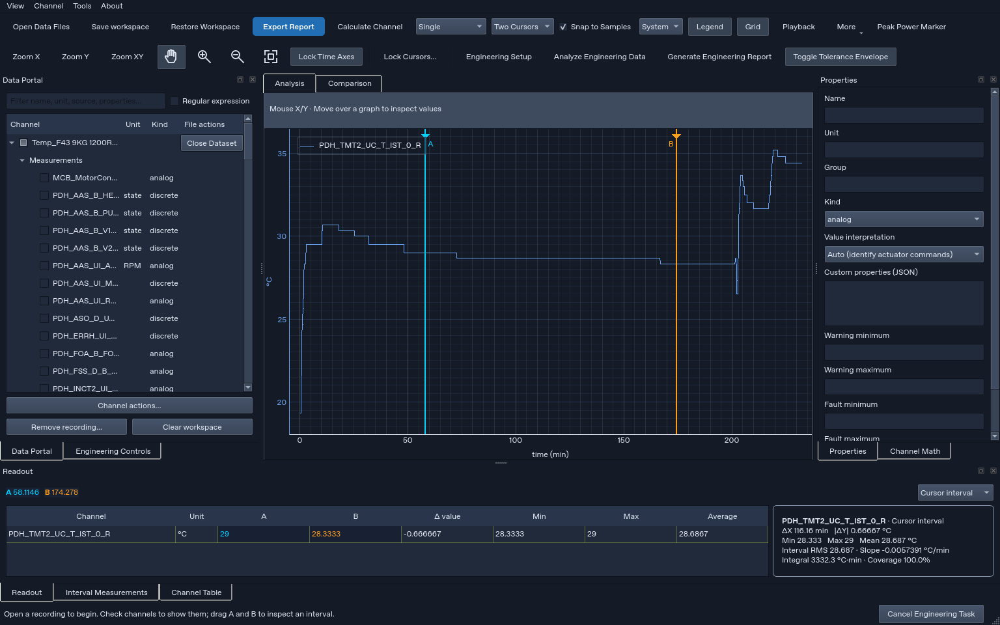
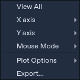
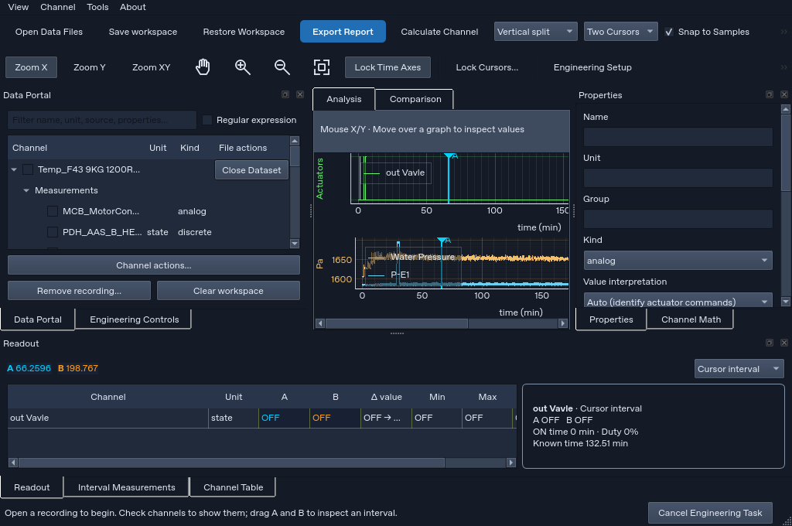
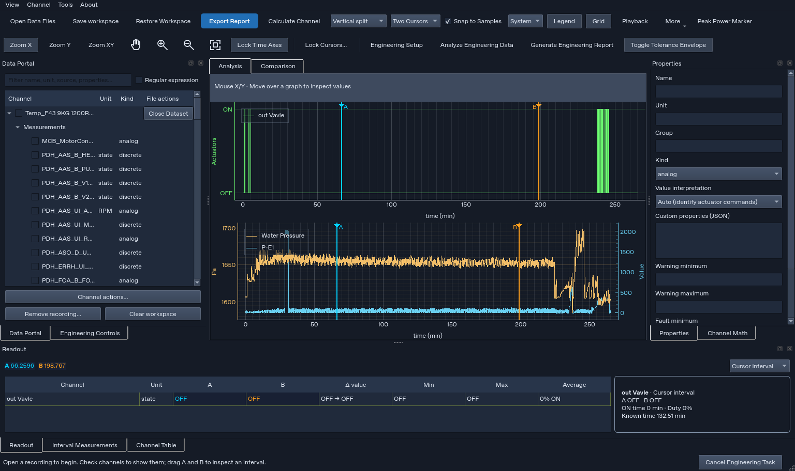
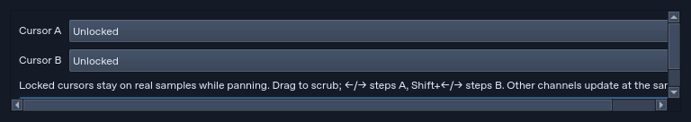
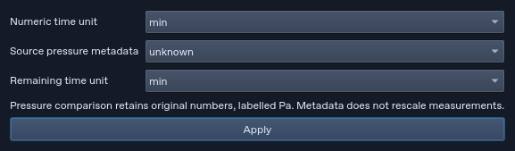
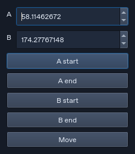

# Real-recording usability and reliability audit — 18 October 2026

**The current v2.3.1 application does not meet the requested chart-navigation and time-lock behavior.** This audit uses the four newly supplied recordings and the user's task expectations. It publishes evidence and acceptance requirements; it does not implement application fixes or produce a new executable.

Tested application source: `788369c` (application unchanged from the preceding retest). Linux, Python 3.12.14, Qt offscreen. Native Windows appearance, physical DPI and executable packaging were not tested here. Earlier reports accepting the global toolbar used the wrong placement criterion; that conclusion is superseded by the user's explicit requirement: **inside the graph-panel header, beside Analysis/Comparison**.

## What a user can currently rely on

All four originals are now [reusable repository fixtures](../../../tests/samples/recordings/README.md), with original filenames, byte counts and SHA-256 checksums. All originals remained unchanged during testing. These particular inputs yield 91 channels across four original datasets; the supplied simulation contains 106,148 rows, not the 120,666-row simulation in an earlier handover.

| Workflow exercised | Observed result | What this establishes |
| --- | --- | --- |
| Every nonempty combination of the four files | 15/15 combinations passed | Imports, channel retention, plotting, cursor stepping, deselect/reselect and removal checks completed |
| TDMS parameter review and restart | Passed, 27 reviewed/template channels | Saved parameter definitions reused without unknown channels |
| Active-interval CSV/XLSX/PDF/PNG | Passed, 91 summary channels and 6,527 source rows | These export paths completed for the actual mixed inputs |
| Full mixed workspace save/load | Passed, all 91 channels and four original datasets preserved exactly | Original source tables and channel arrays survived restoration |
| PD + RD engineering alignment | Four strategies completed; reruns added no duplicate channels | Mechanical alignment operations worked, not proof that chosen event offsets are physically correct |
| PD + TDMS engineering alignment | Four expected rejections | No-overlap/missing drum feedback rejected rather than silently inventing support |
| RD vs simulation / TDMS vs simulation | Both comparison operations completed | Outputs included RED, VALUE, MISSING and REVIEW statuses; completion is not appliance acceptance |
| Twelve real PD processing operations | Eleven completed with defaults; low-pass completed after valid cutoff retry | Numerical operations run; invalid default remains a usability defect |
| Unrelated-clock formula | Correctly rejected | Explicit resampling required rather than silent clock mixing |
| Lock off | Independent windows retained | Independent inspection works in the exercised case |

The import/persistence/export diagnostic has **18 passing scenarios**, including the 15 combinations. The engineering diagnostic has **six completed operations, four expected rejections, zero unexpected failures**. Separately, the new user-contract diagnostic has **20 checks: four met, 16 unmet**, plus **two actual application callback exceptions and zero audit-runner errors**. Eleven of the unmet checks are variants of one time-lock defect; these are not 16 independent root causes. The prior 268-test regression run (267 passes and one Windows-only skip) does not negate these failures.

## Findings in order of user impact

| Priority / finding | What the user experiences | Required acceptance behavior |
| --- | --- | --- |
| P1 — Time locking is inconsistent | Different panes show different time intervals while Lock Time Axes is on; comparisons can mislead | Every compatible temporal pane has identical numeric endpoints after every supported view operation |
| P1 — Locked cursor disagrees with readout | On RD Drump Speed at 93.2306667 min the actual marker is −10, while A readout says −15 | Marker and readout identify the same real sample, including duplicate timestamps |
| P1 — Native right-click transform errors | Native FFT on/off each raises `AttributeError: ScatterPlotItem has no setFftMode` | Expose supported application actions; remove incompatible framework actions and verify no callback errors |
| P1 — Requested navigation location remains wrong | Zoom tools are in the global toolbar above the graph tabs, not beside them | Move the primary set into the graph header beside Analysis/Comparison; share actions with menu/shortcuts |
| P2 — Context menu does not match chart tasks | User sees View All / axes / Mouse Mode / Plot Options instead of familiar Hand, Cursor and Zoom actions | Provide the requested pane-scoped chart menu with previous zoom, comments and copy/export |
| P2 — Minimum-size split panes become unusable | At 1024×680 drawing heights were only 65.1 and 66.1 logical pixels | Give panes usable minimum drawing space or scrolling; never crush them to strips |
| P2 — Filter default is invalid for loaded data | Default 1 Hz cutoff fails on approximately 1 Hz samples (Nyquist 0.5 Hz) with a SciPy error | Show sample rate and valid cutoff range before Apply; choose a valid default |
| P2 — Some simple forms are too wide | Cursor-lock form is 768×136, with an unwrapped explanatory sentence | Wrap help and size to fields; retain readable long names and reachable buttons |
| P2 — Physical units need confirmation | Generic PD channels have no declared units; integral is shown as `·min` | Clearly identify unknown units, request/allow confirmation, never imply Wh without confirmed W |
| P2 — Large persistence needs visible progress | Exact mixed snapshot produced 231,755,668 bytes of JSON; save/load/equality sequence took 28.115 s | Show progress and recovery for long operations; consider a compact exact-preserving representation |

The 28.115 s measurement includes saving, loading and equality verification; it is **not** a measured 28-second UI freeze. Synchronous generic save/export paths are a source-inspected responsiveness concern. The separate engineering report worker already has asynchronous/cancellation behavior and should not be described as entirely synchronous.

### Why time locking sometimes appears correct

The diagnostic checks equal numeric intervals to absolute tolerance 1e-7. **Eleven of twelve locked scenarios failed.** A horizontal split passed; vertical layouts with differing axis margins did not.

| Action/layout | Pane intervals (minutes), representative observed output |
| --- | --- |
| Vertical, same units | 40–80 versus 40.7463–80 |
| Vertical, mixed independent axes | 40–80 versus 40.7463–77.3134 |
| Horizontal, mixed independent axes | 40–80 versus 40–80 — passed |
| Resize while locked | 40–80 versus 41.0949–76.0584 |
| Pan second pane | 58.1211–126.7641 versus 60–120 |
| Zoom X | 44–76 versus 44.8759–72.8467 |
| Fit, hide/show, theme, tab switch, restore | Each retained unequal numeric intervals |
| Four-pane grid | Three panes 40–80; fourth 41.2048–75.6627 |

Source inspection confirms `setXLink` delegates to PyQtGraph's screen-geometry linking: overlapping panes compensate for their differing pixel margins. This explains why adding independent Y axes changes numeric endpoints. A fix needs shared numeric X-range state, consistent padding and recursion protection; also align margins where physical cursor alignment is desired. Turning time lock on must immediately adopt a clearly defined active range. Do not confuse view locking with shifting recordings to align test events.

### Correct header and right-click behavior

The authoritative [acceptance requirements](../../USER_WORKFLOW_ACCEPTANCE.md) record the user's placement and reference-menu intent. The header should contain `[Analysis] [Comparison]` followed by Zoom X/Y/XY, Hand, zoom in/out, Fit and locking controls, with graph-header overflow at narrow sizes. It must not be another global toolbar or an overlay on signal data.

The right-click menu should act on the clicked pane: Hand/Pan (Esc), Cursor, Zoom XY/X/Y, Snap to cycles, Revert zoom, Comments/Move comments, Copy chart and application export. Unsupported actions should explain their prerequisites; do not fabricate cycle definitions or IEC/STGS evaluation support from a screenshot. Revert means previous view, not Fit all. The current native FFT checkbox raises a real Qt callback error and leaves the pane's domain coordinate declared as time/min; it must not serve as the application's supported frequency-analysis route. The separate application FFT operation succeeded.

### Dialog inventory and density

[All 16 inspected dialogs and measured sizes](dialogs.csv) are published, with relevant screenshots below. Small dialogs already include Plot Display 238×210, Move Cursors 227×259, and Tolerance 362×154. Keep them compact. Cursor Locks 768×136 and Reference Units 577×169 have unwrapped explanatory labels. Anchor configuration 747×219 is affected by long source names. Wrap explanatory text and elide long selections with full tooltip access rather than widening the entire form.

Large tables need a different criterion: Channel Mapping and Measurements 720×420, Engineering Setup 768×420, and TDMS review 776×650 have substantial tabular content. They need resizable layouts, readable columns, scrolling and reachable buttons, not an arbitrary small width. The offscreen screen is 800×800; these are Qt logical dimensions, not a native Windows DPI certification. At 1536×912 the exercised split sequence had usable 189.1/188.1 drawing heights; at 1024×680 it collapsed. Earlier sequence-dependent collapse remains relevant: one good large-window screenshot does not prove robust resizing.

## Coverage and remaining acceptance work

| User task family | Evidence available now | Still required before calling it fully accepted |
| --- | --- | --- |
| Load, combine, organize, remove | All 15 input combinations, original hash retention, file removal | Duplicate file opening policy, malformed/truncated/permission-denied input recovery |
| Plot and navigate | Every available layout inventoried; mode/real mixed-axis range checks; two window sizes | Fix header/menu/range defects; physical mouse wheel/box/history checks on Windows |
| Inspect cursor/interval | Stepping/bounds and actual duplicate marker/readout reproduced | After fix, repeat masked/gapped/discrete endpoints and keyboard/drag identity across all views |
| Process channels | Twelve real-data operations, clock rejection, valid-cutoff retry | Unit-confirmed numerical acceptance against an independent reference for every operation; busy/cancel/error recovery |
| Align and compare | Eight alignment attempts and two comparisons with explicit statuses | Confirm physical event correspondence with domain owner; do not infer matching cycles from filenames |
| Configure rules/calibration/extensions | Sixteen dialog forms inspected; earlier regression evidence exists | Execute each domain configuration with representative valid/invalid data; extension lifecycle and recovery |
| Persist and export | Exact mixed workspace roundtrip; interval CSV/XLSX/PDF/PNG | Failure/overwrite/disk-full recovery, large-workspace progress, native print and other format scenarios |
| Accessibility and presentation | Two window sizes, theme-change effects, screenshots | Keyboard-only task completion, screen reader, contrast measurement, Windows 100/125/150/200% DPI and multiple monitors |
| Installer/updater and long runs | Prior regression evidence only | Fresh packaged Windows smoke test, updater rollback, prolonged load/interaction and graphics-driver tests |

This is a finite reproducible audit, **not a claim that every possible scenario has been tested**. The supplied files describe different runs/loads; comparison status counts are diagnostic outputs, not certified NI DIAdem or appliance-standard compatibility. Any fix should first convert the unmet expectations into regression acceptance checks, then repeat the real-data scenarios and native Windows validation.

## Published evidence and reproduction

- [Original fixtures and SHA verification](../../../tests/samples/recordings/README.md)
- [User-contract JSON](user-contracts.json), [flat checks CSV](contracts.csv), [application exception log](user-contracts-console.txt)
- [All file combinations, exports and snapshot results](recording-combinations.json)
- [Engineering alignment/comparison results](engineering-results.json)
- [Dialog inventory CSV](dialogs.csv)
- [Reusable user-workflow diagnostic](../../../tools/audit_user_workflows.py), [sample verifier](../../../tools/verify_recording_samples.py)

Run `python tools/verify_recording_samples.py`, then `QT_QPA_PLATFORM=offscreen python tools/audit_user_workflows.py --output /tmp/analizer-user-audit` from the project root after installing project dependencies. Set writable cache directories where required. The diagnostic deliberately exits 1 for unmet requirements; consult separate application-callback and runner-error counts. The huge generated workspace and machine settings are not committed.

## Screenshots

Current misplaced header:

Current right-click menu:

Real mixed data at minimum window size:

Real mixed data at a larger window size:

Cursor-lock and reference-unit forms:

