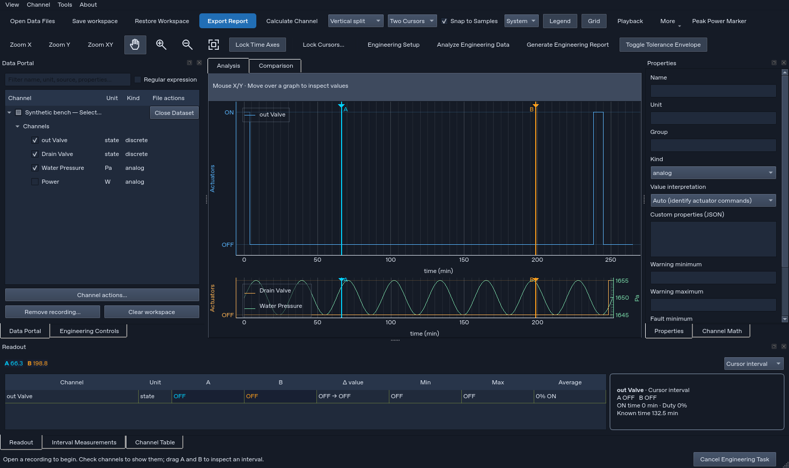
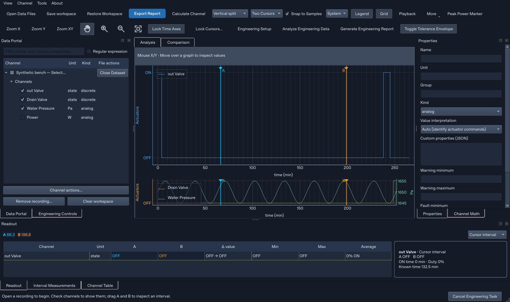
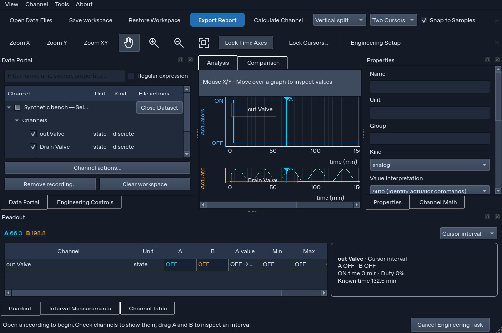
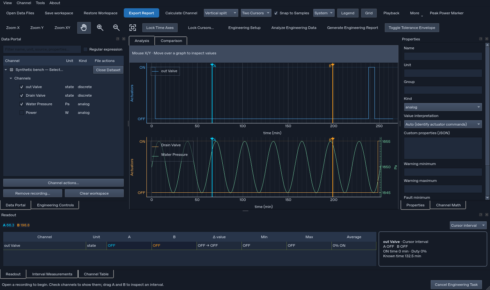

# v2.3.1 UI retest — 18 October 2026

**Result: substantial improvements verified, but the split-plot layout is still defective.** The compressed lower graph in the supplied screenshot reproduces in the current source. Passing the existing test suite does not establish that both split panes remain readable.

Source inspected and executed: **8c3ce86**, application **2.3.1**, including application changes at **1b8fe71**. The supplied screenshots identify v2.3.1. Source was fast-forwarded from GitHub before testing. No application code or executable was changed by this retest.

## Test results

| Check | Result | Evidence / scope |
| --- | --- | --- |
| Full repository suite | **267 passed; 1 skipped; 268 run**, 141.866 seconds | [Full test log](full-tests.txt). The skip is the native PowerShell replacement/rollback transaction, which requires Windows. |
| Source GUI/application self-test | **Passed**, version 2.3.1, 25 recorded checks | [Self-test report](source-smoke.json): Qt startup, icons/manual, cursor/navigation, TDMS, snapshots, plots, exports, engineering energy, PDF and nine-sheet workbook. |
| Split-pane readability | **Failed proposed readability acceptance** | Independently reproduced compressed lower pane; the existing regression suite does not assert balanced drawing heights. This is separate from the passing regression count. |
| Cursor lock and sample stepping | **Passed** | Both A/B locked to the chosen real channel. A stepped from 66.3 to 66.4 min, a real sample. Pan retained locked positions. |
| Single navigation set and icons | **Passed** | No duplicate quick-zoom widget or tab-corner navigation; Zoom In, Zoom Out, Fit and Pan all have non-null icons. Existing mode/link/shortcut tests passed. |
| Light/dark legend text | **Passed** | Repeated Dark → Light → Dark → Light ends with actual rendered label HTML at `#182033`, replacing the old pale-on-white defect. |
| Comparison PDF signed delta | **Passed** | [Extracted PDF text](comparison-delta.txt) contains the supplied `+15.00 W` signed delta, plus `+15.00%` and match 85. |
| Explicit interval power energy | **Passed** | 3600 W from 2 to 4 min displays **120 Wh**, with 100% coverage and the W·min intermediate integral. |
| Automatic preset colors | **Passed in probe and existing test** | No mismatches between effective trace colors and serialized presets. The suite also passes the distinct-copy color test. |
| Scale checks | **Passed within existing suite** | Fresh Qt processes test factors 1, 1.25 and 1.5. An additional 1.25 probe reproduces the split defect. These are Linux/offscreen results, not new native Windows certification. |

The environment initially lacked the newly required npTDMS package; the repository-pinned **npTDMS 1.12.1** was installed before running tests. This was an environment prerequisite, not an application failure.

## 1. Main remaining defect: lower split pane is squeezed

Synthetic reproduction follows the supplied screenshot: upper pane has `out Valve`; lower pane has `Drain Valve` and `Water Pressure`; the layout is Vertical split with linked temporal coordinates. Source data is synthetic and does not purport to reproduce the supplied recording's numerical values.

Steps:

1. Open/populate one temporal plot, leaving the ordinary side docks and Readout visible.
2. Change from Single to Vertical split.
3. Put the second actuator plus pressure in the lower pane.
4. Resize the window, switch active panes, and inspect actual ViewBox drawing heights rather than just widget visibility.

| Window size, Qt logical pixels | Upper pane widget height | Lower pane widget height | Upper drawing height | Lower drawing height |
| --- | ---: | ---: | ---: | ---: |
| 1536 × 912 | 337 | 116 | 299.1 | **78.1** |
| 1024 × 680 | 139 | 68 | 101.1 | **30.1** |
| 1920 × 1140 | 451 | 230 | 413.1 | 192.1 |
| Return to 1536 × 912 | 337 | 116 | 299.1 | **78.1** |

A second fresh process at **QT_SCALE_FACTOR=1.25** reproduced the same 299.1/78.1 logical drawing heights. Its 1536×912 logical window produces a **1920×1140 pixel capture**, matching the dimensions of the supplied full-window screenshot. Offscreen font/window-system differences still apply.

At minimum width, the workspace is also only **330 px** wide, while a pane requests **534 px**. The Readout is 660 px wide with 718 px of column content. The earlier narrow-window/scrolling concern therefore remains.

### Cause supported by source and a controlled diagnostic

In [`PlotWorkspace.set_layout`](https://github.com/swarajsuman321-dev/Analizer/blob/8c3ce86/app_plot_workspace.py#L656):

- Both visible grid row stretch values remain **0**.
- Two-pane layouts receive a **0 px** explicit pane minimum height; the 180 px minimum applies only when there are at least three panes.
- Qt allocates space using differing existing/new widget size hints. In the reproduced sequence, the pre-existing upper pane retains much more space than the new lower pane.

An **in-memory diagnostic only**, setting both row stretches to 1 and both pane minimum heights to 180 px at the same 1536×912 window, produced:

| Diagnostic result | Upper | Lower |
| --- | ---: | ---: |
| Pane height | 227 px | 226 px |
| Drawing height | 189.1 px | 188.1 px |

This local experiment supports the layout diagnosis. **It is not a shipped fix, source change, or updated EXE.** No saved user workspace was overwritten.

Recommended application correction:

- Define balanced stretch for all visible rows/columns, and clear obsolete stretch/minimums when layouts shrink.
- Give split panes meaningful minimum drawing space; let the existing scroll container handle insufficient screen height instead of crushing one plot.
- Alternatively, use a vertical splitter with an initial equal allocation and persisted user-adjustable proportions. Do not introduce a second navigation engine.
- Add explicit geometry acceptance tests for Single → Vertical split, import order, mixed actuator/analog axes, resize, tab switching, hiding/showing traces, saved-workspace restoration and 100/125/150% scale.
- A reasonable **proposed** normal-window gate is at least 150 logical drawing pixels per pane and a balanced initial split, unless the user deliberately chooses different proportions. On smaller windows, scrolling must preserve the minimum usable pane size. This is a proposed acceptance criterion, not an already implemented product guarantee.

### Screenshot comparison

**Unmodified v2.3.1, two-pane layout at 1536×912 logical pixels:**

**Unmodified v2.3.1 at 125% scaling, physical capture 1920×1140:**

**Unmodified v2.3.1 at 1024×680:**

**Diagnostic only — balanced rows in the test process; not implemented in the app:**

## 2. Interpretation of the supplied cursor/navigation screenshots

- The compact cursor-lock dialog is an improvement and opens correctly in the retest. In the probe it measured 768×136 logical pixels; native font/style/DPI can change that size.
- `Unlocked` means no channel anchor has been chosen yet. It is not by itself a failure. Selecting a real channel and Apply successfully creates locks for A and B.
- The lock lists contain channels from the **active pane**. With `out Valve` active in the upper pane, the list contains Unlocked and out Valve. To lock to Drain Valve or pressure, activate their pane first. Clearer pane/source labeling would improve this workflow.
- Locked positions survive panning; sample stepping follows real sample indices. The actual sample clock, not display-pixel position, governs the lock.
- Selecting Zoom X intentionally constrains zoom to the temporal axis. A magnifier not changing Y while that mode is selected is expected behavior. Existing Zoom X/Y/XY, linked axes, history and keyboard behavior tests passed.
- The primary toolbar now has one icon-bearing Pan/Zoom/Fit presentation, and Analysis/Comparison tabs no longer contain duplicate quick navigation. The old duplication finding is resolved.
- Readout is **active-pane scoped**. Channels checked in another pane remain plotted there but do not automatically appear in the currently active pane's readout. This explains the presence of only out Valve in the shown readout; it does not establish that the other channels were lost. A visible active-pane label would make the scope clearer.
- OFF at A/B, 0% duty and 0 min ON in the screenshot do not alone establish a numerical defect. Those values can be correct if the selected out Valve interval contains no ON support. The original source recording and saved workspace would be needed to independently verify those particular recording values; this retest used synthetic data.

## 3. Earlier audit: current status by finding

Original findings apply to `2f76bc5`; this table records only what is supported on v2.3.1. “Fixed” is scoped to the stated finding/check and does not certify all related interactions.

| Original ID | v2.3.1 retest status | Evidence / remaining limitation |
| --- | --- | --- |
| F01 — same-named traces lack recording identity | **Still open** | Two source datasets still produce readout names `Temperature`, `Temperature`. Deliberate comparison is supported but unqualified labels remain ambiguous. |
| F02 — cramped minimum-size layout | **Still open; split defect reproduced** | 330 px center workspace, horizontal readout overflow, and 78.1/30.1 px lower drawing area in the tested sizes. |
| F03 — PDF omits signed difference | **Fixed in focused probe** | Generated PDF includes `delta` and the supplied `+15.00 W`. |
| F04 — pale legend text after theme switch | **Fixed in focused probe** | Rendered HTML ends at `#182033` in light theme after repeated switches; dedicated regression passed. |
| F05 — cascading dataset close without undo | **Still open, source inspection** | Dataset removal continues through dependent derived channels; no dependency-aware undo was found. Original files remain protected. |
| F06 — duplicate primary navigation / hidden toggles | **Fixed for stated UI concern** | One navigation presentation; direct Legend/Grid and compact playback are present. Secondary menu access remains useful. |
| F07 — text-only navigation and inconsistent terminology | **Improved / partial** | Icons and accessible names now pass. Header still says Zoom X/Y/XY while menus use expanded time/value terminology. |
| F08 — missing compact interval rate/Wh | **Fixed for supported analog/power channels** | Compact card includes RMS, Slope, Integral, Coverage and explicit 120 Wh in the verified power example. Actuator card intentionally shows state/duty/ON time. |
| F09 — generic worker progress/cancel | **Partially improved** | Engineering analysis/report has cancel support and preservation tests. Generic import/calculation still uses Working… without equivalent per-file progress/cancel. |
| F10 — synchronous export | **Partially improved** | Generate Engineering Report uses the engineering worker/cancel path. The older Export Report action still calls its exporter synchronously. |
| F11 — filtered Select All affects hidden results | **Still open** | Temperature filter shows one channel from a file, while the file-wide action affects both channels in that file. File/all semantics remain explicit but no filtered-only alternative is offered. |
| F12 — routine raw JSON/comma syntax | **Still open** | Properties still exposes JSON; local unit entry still uses comma-separated symbol/reference/scale. New engineering configuration also retains an advanced JSON profile editor. |
| F13 — blanket oversized dialogs | **Improved; bounded forms passed** | ContentDialog/DialogBounds and compact lock form are present; scale/form tests pass locally. This does not resolve main-window pane allocation or establish new native Windows DPI certification. |
| F14 — appearance unexpectedly affects both workspaces | **Fixed for tested active-workspace changes** | Active-workspace checked toggles and roundtrip isolation tests pass; settings use targeted application without unnecessary rebinds. |
| F15 — preset/duplicate automatic colors collapse | **Fixed in probe and regression** | Preset colors matched effective colors; existing test also verifies a copied channel gets a distinct automatic color. |
| F16 — CSV/Excel report payloads differ under shared label | **Still open in legacy export route** | CSV writes interval samples; Excel adds summary and optional comparison. New engineering PDF/Excel is a distinct, more capable route. |
| F17 — Updates/About terminology | **Still open, minor** | Updates still opens the About window, while User Manual is separate and usable. |
| F18 — invalid regex explained only by red border | **Still open** | Invalid regex handler still returns after coloring the border; no inline explanation is provided. |

New engineering capabilities are present and covered by the suite: validated appliance profiles, reviewed mapping/unit conversion, run roles, phase/KPI calculations, quality/coverage, configured tolerances, traceable PDF/nine-sheet Excel and cancellation. Their presence should not be mistaken for resolution of F01/F02 or universal progress/cancel in every older workflow.

## 4. Follow-up priority

1. **Fix split-pane allocation first.** It directly reproduces the supplied screenshot and has a demonstrated diagnostic correction.
2. **Qualify source/active-pane identity** in legends, cursor selectors and readout, retaining original technical names and stable channel IDs.
3. **Protect unsaved derived work on dataset removal** through dependency visibility and reversible unload.
4. Finish narrow-window readout adaptation and filtered selection clarity. Preserve all engineering capabilities and precision tools.
5. Unify progress/cancel and reporting semantics gradually; do not remove existing diagnostic/source exports or change scientific calculations as a layout workaround.

All regression tests can pass while a specific usability acceptance criterion fails. Add the missing geometry checks rather than interpreting the current green suite as proof that the compressed lower pane is acceptable.

## Evidence and reproducibility

- [Runtime observations, geometry and focused assertions](observations.json)
- [125% process observations](observations-125.json)
- [Full suite log](full-tests.txt)
- [Source self-test](source-smoke.json)
- [Generated PDF](comparison-delta.pdf) and [extracted text](comparison-delta.txt)
- [Probe script](probe.py) and [probe console output](probe-output.txt)

The normal geometry measurements were captured **before** the in-memory diagnostic adjustment. Later theme/energy/report checks use the same numerical data and do not claim an application source fix. Test scripts use isolated output/settings directories and synthetic data. No private recording or supplied screenshot was committed as raw data.

Example local execution uses Python 3.12.14 with the pinned build requirements, `QT_QPA_PLATFORM=offscreen`, and isolated `ANALIZER_OUTPUT_DIR` / `ANALIZER_SETTINGS_DIR`. Full suite command: `python -m unittest discover -s tests -v`. A separate Qt scaling test launches fresh processes at 1/1.25/1.5; the extra screenshot probe uses `QT_SCALE_FACTOR=1.25`.

This retest **did not build or execute a Windows EXE**, validate the user's exact recording, or certify physical monitor/driver/screen-reader behavior. The repository's [existing native release record](https://github.com/swarajsuman321-dev/Analizer/blob/8c3ce86/docs/validation/release-v2.3.1.json) records 268 Windows passes and packaged/restart checks for v2.3.1; that is prior release evidence, not today's Linux run. The new retest is published as documentation/evidence only; no new application version is produced.
