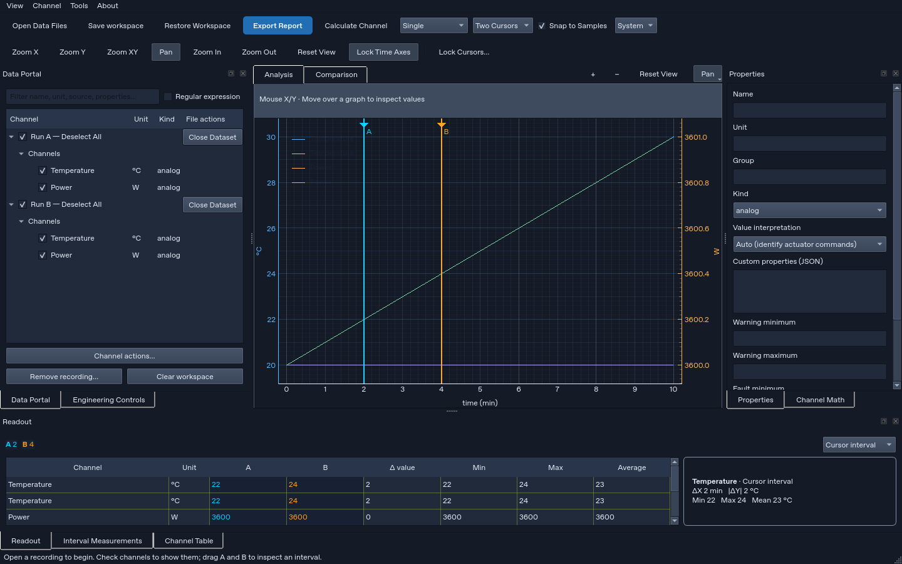
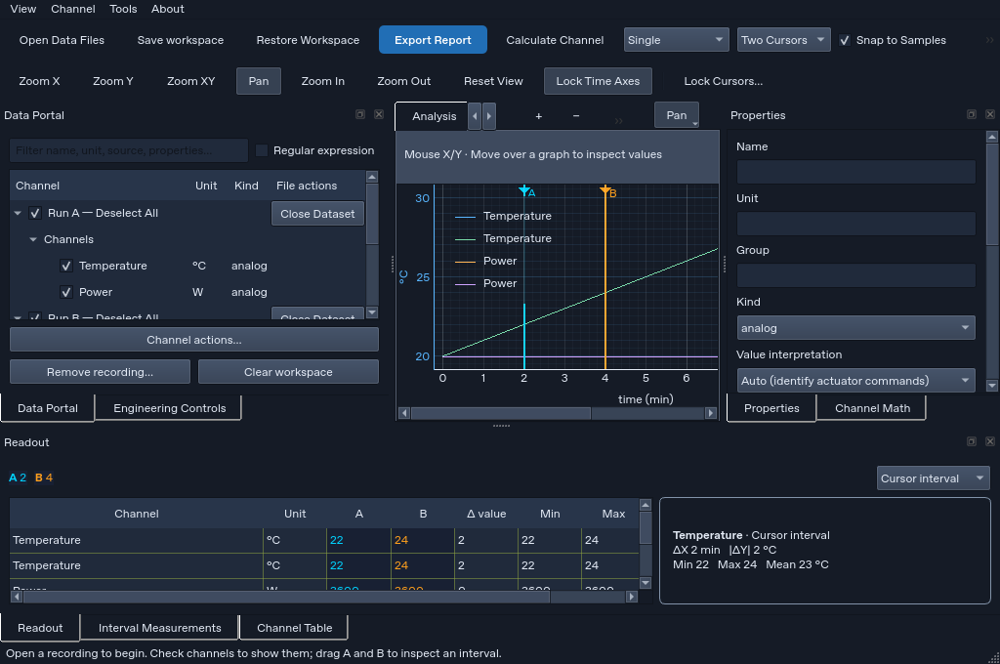
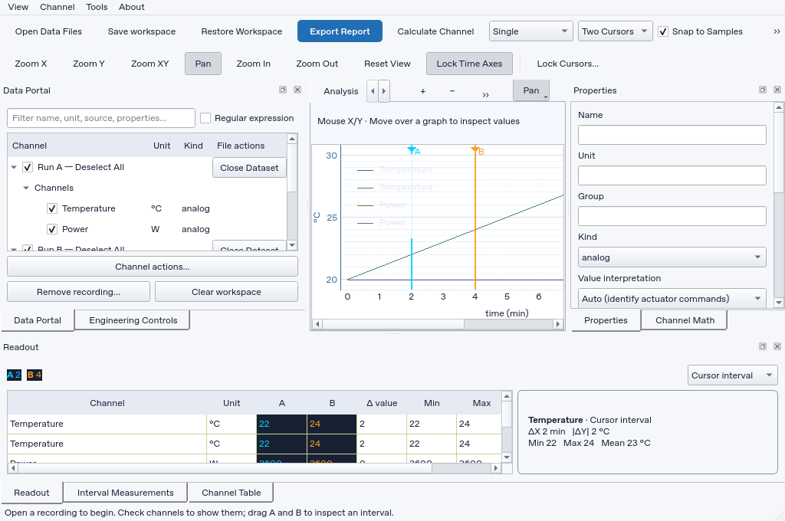

# Analyzer UI/UX simplicity audit — 18 October 2026 (IST)

**Overall finding:** preserve the engineering engine and simplify its presentation. The highest priorities are reliable identification of each recording, readable plots at the supported minimum size, correct comparison-report content, theme contrast, and reversible dataset removal. Adding more toolbar buttons before addressing those issues would increase cognitive load.

**Audited source:** `swarajsuman321-dev/Analizer`, main commit **2f76bc592a4465d297907d089dd3f83c92936625**, application version **2.2.3**. This source is three commits newer than the successful v2.2.3 Windows build at `37a1919`. The latest documentation already records several open improvements; this report independently checks the requested workflows against the current code.

**Method:** inspect frontend controls, menus, tooltips, import/removal, plotting/navigation, measurements and export code; run an isolated Qt offscreen session using two synthetic recordings; inspect dark/light screenshots at 1024×680 and a larger 1440×900 view; generate an Excel interval workbook and a comparison PDF; inspect extracted PDF text; run relevant existing UI regressions. **36 targeted tests passed with no skips.** This is an expert heuristic review, not a timed study with engineers, a full regression run, or native Windows/DPI certification. Application source was not modified. The local checkout was fast-forwarded to the audited GitHub commit.

**Evidence files:** [runtime observations](observations.json), [test log](targeted-tests.txt), [dark minimum-size capture](workbench-dark-1024.png), [light minimum-size capture](workbench-light-1024.png), [larger capture](workbench-dark-1440.png), [PDF text](comparison-probe.txt), [legend rich-text state](legend-probe.json), and [declared control inventory](control-inventory.csv). All recordings used here are synthetic. The static control inventory contains **228 declarations** across 6 modules; dynamic labels are marked for caller/context inspection. It supports the label/menu/tooltip review and is not a claim that every generated dialog was exercised.

## Audit screenshots

These captures show the audited application with synthetic recordings. Select an image to open it at full size.

### Dark theme — 1440 × 900

[](workbench-dark-1440.png)

### Dark theme — 1024 × 680

[](workbench-dark-1024.png)

### Light theme — 1024 × 680

[](workbench-light-1024.png)

## Section 1: Usability Heuristic Audit Scorecard

Severity: **Critical** blocks safe completion or establishes serious data integrity loss; **High** risks misinterpretation or seriously impedes a core task; **Medium** creates repeated friction or weakens confidence; **Low** is localized discoverability/consistency debt. No Critical issue was established in this audit. The table contains **5 High, 9 Medium, and 4 Low** findings. “Source” means code-confirmed, without claiming a runtime reproduction of every path.

| ID | UI component / screen area | Observed design / workflow issue | Violated heuristic / law | Severity | User impact and evidence |
| --- | --- | --- | --- | --- | --- |
| F01 | Import, legends and Readout | Two same-clock files are automatically plotted together. Dataset identity remains in the portal, but legends and readout rows display only channel names. Two `Temperature` traces cannot be distinguished by their labels. | Error prevention; match to real world; recognition over recall | **High** | Confusion and wrong-recording interpretation. Runtime reproduced; [E1], [E2]. Intentional overlays must remain supported, with explicit file labels. |
| F02 | Minimum-size layout | At 1024×680, the plot workspace measured **330 px** wide. The 340 px interval card leaves a 660 px readout with **716 px** of column content. The Comparison tab is pushed into tab scrolling, and plotting requires horizontal scrolling. | Aesthetic/minimalist design; Fitts; visibility of system status | **High** | Visual clutter, navigation friction, partly hidden values/axes. Runtime screenshots and measurements; [E3]. |
| F03 | Comparison PDF | Renderer requests `diff`, while the comparison model emits `delta`. A supplied `+15.00 W` difference disappeared from the generated PDF; reference/candidate values, percent and match remained. | Consistency; visibility of system status; error prevention | **High** | Missing engineering evidence in a supposedly complete report. PDF generated and text inspected; [E4]. This is a confirmed report defect, not merely an aesthetic preference. |
| F04 | Legend after theme changes | Dark → Light leaves actual legend rich text at `#e3eaf5` on a white fill, despite the label option being updated to `#182033`. Measured nominal contrast is approximately **1.21:1**. | Visibility; consistency; recognition | **High** | Channel names become difficult to read. Screenshot plus live rich-text inspection; [E5]. This does not establish a full accessibility compliance result. |
| F05 | Close Dataset / Remove recording | Immediate per-file close is valuable, but removal also recursively deletes dependent derived traces, potentially from another dataset. That path has no visible dependency preview or undo. | User control/freedom; error prevention/recovery | **High** | Accidental loss of unsaved workspace work. Source [E6]. Original recording files remain safe; this is not an assertion of disk-file deletion. |
| F06 | Graph navigation and plot settings | Zoom In/Out/Reset and mode controls appear in the main navigation toolbar, the tab-corner quick controls, and Tools → Plot. Grid/legend switches instead require a settings dialog and Apply. | Hick; consistency; minimalist design | **Medium** | Repeated choices and extra clicks. Both toolbar presentations were visible in the probe; [E7]. The actions are shared, so this is duplication of presentation, not competing calculation engines. |
| F07 | Navigation labels / icons | Primary controls use `Zoom X`, `Zoom Y`, `Zoom XY`, while menu labels say Time/Value/Both Axes. Zoom/Pan/Reset action icons are null; quick buttons use `+`/`−`. | Match to real world; consistency; recognition | **Low** | First-time engineers must learn two vocabularies. Icon state reproduced; [E7]. Retain text and accessible names when adding icons. |
| F08 | Interval card / heating analysis | The compact card gives ΔX, absolute ΔY, Min/Max/Mean but omits heating rate and explicit Wh. Detailed measurements expose Slope and Integral, so engineers must discover another tab and interpret/convert units. | Match to real world; flexibility/efficiency; recognition | **Medium** | Click fatigue and manual-conversion risk. Current interval export has no explicit `energy_Wh`; [E8]. Existing time conversion is intentional, not a demonstrated numerical bug. |
| F09 | Long-running imports/calculation | Generic data workers show `Working…`; no per-file progress, stage, or cancellation is exposed there. Only the Apply button is disabled, and conflicting actions can produce “wait” warnings. | Visibility of system status; user control; error prevention | **Medium** | Uncertainty and avoidable interruptions. Source [E9]. The separate updater already has progress/cancel; do not conflate it with the data-worker path. |
| F10 | Export responsiveness | Export is called synchronously from the GUI action; it builds interval data and renders/writes files before returning. | Visibility of system status; flexibility/efficiency | **Medium** | Large exports can make the UI appear stalled. Source [E10]; no universal freeze duration or throughput claim was measured. |
| F11 | Filtered per-file Select All | With filter `Temperature`, one visible channel in a file still gives a Select All operation covering both Temperature and Power. The existing label says all channels in the file but provides no visible/total count. | Error prevention; recognition; user expectations | **Medium** | Unexpected channels can enter the plot. Runtime reproduced; [E11]. Keep distinct “all in file” and “filtered results” actions rather than silently changing semantics. |
| F12 | Properties and unit definition | Main Properties includes a raw JSON editor; defining a unit requires entering comma-separated symbol/reference/scale. Selection cardinality and channel applicability are usually validated after clicking. | Match to real world; recognition; error prevention | **Medium** | Novice confusion and avoidable validation dialogs. Source [E12]. Expert metadata editing should remain available under Advanced. |
| F13 | Dialog sizing | Shared tool dialogs default to 820×580, regardless of a small form versus a large table; About/Manual open at 1050×760. Display options opened at 820×580 in the probe. | Fitts; aesthetic/minimalist design | **Medium** | Excess space, movement, and potential screen-bound conflicts. Source/runtime [E13]. Opening hints do not prove a dialog cannot subsequently resize. |
| F14 | Display-options scope | Applying display options modifies and rebinds panes in **both** Analysis and Comparison, although the interaction starts from the active plot context. | User control; consistency; visibility of scope | **Medium** | Changes can affect an unseen workspace. Source [E14]. Offer Active view versus All views explicitly; preserve intentional global settings. |
| F15 | Color meaning across presets / duplication | Automatic colors live in `trace_color`, but channel-preset serialization defaults missing `plot_style.color` to blue. Duplication copies automatic-color metadata. | Consistency; recognition | **Medium** | Trace color meaning can collapse after preset use or copying. Source [E15]; previously documented independently too. Fix identity/color persistence without overriding user-selected colors. |
| F16 | Export Report format choices | PDF, Excel and CSV share one report command, but CSV writes interval samples only; Excel also includes Cursor summary and optional Comparison. | Match to real world; consistency | **Low** | Users expecting a CSV summary may receive a different payload. Source [E10]. Label payloads precisely; keep all exports. |
| F17 | About / manual terminology | Manual and About are separate windows, as requested. However, the `Updates` action opens a window titled About, and Tools also has About version. | Consistency; recognition | **Low** | Mild wayfinding confusion. Runtime verified; [E16]. Separate Help and About/Updates clearly, without merging their content. |
| F18 | Invalid regex feedback | Invalid regex produces a red border and retains the prior tree; no inline error text explains the syntax issue. | Help users recognize/diagnose/recover; visibility | **Low** | User may not know whether results reflect the current query. Source [E11]. Add text/icon feedback and an easy switch to ordinary search. |

### What already works and should be preserved

- Native per-file tri-state checkboxes and direct Close Dataset; independent datasets in the model, with original source frames preserved.
- Exact Cursor A **Cyan `#00D2FF`**, Cursor B **Orange `#FF9F1C`** in plots/readouts; real-sample locks, keyboard stepping, boundary clamping, and empty-plot messaging. The probe clamped attempts outside a 0–10 min recording back to its boundaries.
- Engineering Controls is raised by default. Data Portal and Engineering Controls share a dock group; that is a discoverability tradeoff, not evidence that engineering controls are missing.
- Separate manual window with topic navigation/search and a separate About/update window; F1 access exists.
- Non-destructive derived channels, recorded source references, workspace persistence, and several existing export formats.
- Direct PDF export already uses one save dialog. An embedded sample-preview pane is absent; an optional illustrative example remains under Tools → Examples. Keep that useful optional example separate from ordinary engineering work.

### Coverage of all ten Nielsen heuristics

| Heuristic | Current assessment / relevant finding |
| --- | --- |
| 1. Visibility of system status | Busy feedback and export scope need improvement: F03, F09, F10, F18. Cursor/state feedback already exists. |
| 2. Match between system and real world | File identity and engineering interval units need clearer presentation: F01, F07, F08, F12, F16. |
| 3. User control and freedom | Preserve per-file removal but add dependency-aware undo and explicit setting scope: F05, F09, F14. |
| 4. Consistency and standards | Consolidate navigation vocabulary, theme colors and persistent trace identity: F04, F06, F07, F15, F17. |
| 5. Error prevention | Explicitly distinguish file roles and filtered selections; expose dependent removal: F01, F05, F11, F12. |
| 6. Recognition rather than recall | File-qualified labels, direct measurement fields and appropriate controls: F01, F08, F12. |
| 7. Flexibility and efficiency | Keep shortcuts; improve repeated Excel export, graph space and processing workflow: F02, F06, F08, F10. |
| 8. Aesthetic and minimalist design | Reduce duplicate controls and rigid panel demands: F02, F06, F13. Preserve capabilities through progressive disclosure. |
| 9. Error recognition, diagnosis and recovery | Make invalid regex actionable, operations cancellable, and removal reversible: F05, F09, F18. |
| 10. Help and documentation | Searchable, separate manual is a strength. Improve action/window naming and context-sensitive engineering help: F08, F12, F17. |

**Accessibility judgment:** do not interpret “purely visual status” as permission to communicate only by color. Keep compact colored badges/swatches plus a numeric percentage, meaningful tooltip, accessible name and an explicit Unknown state. A match percentage is not a Pass/Fail verdict. Avoid adding persistent paragraphs to the graph; move explanations into context help.

## Section 2: Cognitive Friction & Click-Budget Analysis

Counts below are **modeled discrete actions from the code paths**, not measured timings or a human-subject test. Selecting each of two files counts as two actions, opening a menu and choosing an item count separately, and each cursor drag counts once. Typing filenames, operating-system navigation, ambiguous channel mapping, calibration review, and extra scrolling are excluded. Those may add actions in practice. Loading assumes two CSVs, each containing Temperature and Power, matching the runtime probe.

### Task 1 — Load two test files and compare temperature side-by-side

Current viable path:

1. Open Data Files (1); select the two files (2); confirm Open (1): **4** actions.
2. Raise Data Portal from the engineering dock tab: **1**.
3. Deselect each file's Select All because import plotted all four channels: **2**.
4. Open layout list and choose Horizontal split: **2**.
5. Check Run A temperature in the first active pane: **1**.
6. Focus the second pane: **1**; check Run B temperature: **1**.

**Modeled total: 12.** Both sources currently start overlaid; equal channel names remain ambiguous even after rearrangement. Search and narrow-window tab scrolling can add more.

Recommended path: retain the existing generic import but add an explicit, reusable “Compare two recordings” view preset that proposes two file-qualified temperature channels and lets the engineer confirm the pair. **4 import actions + choose comparison preset (1) + confirm pairing (1) = 6**, approximately **6 actions removed**, when an unambiguous temperature mapping is available. Require confirmation for ambiguous units/channels; no invented signal classification or forced cross-file mixing. Deliberate overlay remains a separate explicit choice.

### Task 2 — Scrub a phase interval for heating rate and energy

Assume temperature and verified power channels are already plotted.

- Drag A and B to phase boundaries: **2** actions.
- Open Interval Measurements: **1**; select/locate the desired row as necessary: at least **1**.
- Read endpoint Slope for temperature and Integral for power. The detailed UI expresses minute-based presentation statistics. Converting a power integral from W·min to Wh requires division by **60**. A cumulative Wh channel can instead use B−A, after confirming its meaning and handling resets.

**Current minimum: about 4 actions plus manual interpretation/conversion.** If whole-recording scope is selected, changing scope adds two more actions. Sample locking or numeric cursor positioning adds additional steps; these are useful precision tools, not features to remove.

Recommended: keep A/B handles and existing precision tools; put **Δt, average heating rate (ΔT/Δt), covered power energy (Wh), and coverage** in a compact interval summary keyed to the selected file/channel pair. **2 cursor drags, then read**, eliminating roughly **2 navigation actions and one manual unit conversion**. Distinguish endpoint-average heating rate from a fitted regression or instantaneous derivative.

Verification example: 3600 W for 2 min corresponds to **120 Wh**. Use the existing SI integral divided by 3600, or the W·min presentation integral divided by 60. Validate units, masked/missing support and coverage first; insufficient support must remain Unknown/partial, never zero. Do not label an arbitrary channel integral as energy.

### Task 3 — Generate and obtain a comparison report

Assume the Comparison workspace is active and correctly configured.

- Current PDF: Export Report → Save default PDF: **2 actions**, excluding filename entry. This already meets the requested one/two-click goal. Switching from Analysis adds one action.
- Current Excel: Export Report → open format selector → select Excel → Save: **4 actions**.
- Target: a split Export Report control with explicit repeat-last-format action plus PDF/Excel options. Repeated PDF/Excel exports take **2 actions**, removing approximately **2 actions for repeated Excel exports**.

A desktop export saves to the local chosen path; it is not inherently a browser “download.” Keep the output-folder path visible and offer **Open file / Open folder** afterward. Fix F03 and add appropriate pagination before claiming report completeness. A multi-page PDF must use readable logical sections; the current single-Figure `savefig` path does not implement true multi-page pagination.

### Additional requested click budget — one file, three channels, cursor bounds, report

With auto-plotting of all imported channels: open/select/confirm (3), raise Data Portal (1), deselect all (1), check three channels (3), drag two cursor bounds (2), PDF export/save (2): **12 modeled actions**. A clearly labeled import selection step or remembered plotting policy can avoid the portal detour and deselection: **10 modeled actions**, retaining per-file checks and explicit confirmation for ambiguous imports.

Hick's Law is most relevant to repeated navigation choices and ambiguous export families. Fitts's Law is most relevant to cursor hit targets, small quick-zoom buttons, hidden tabs and long pointer travel between the pane and controls. No unmeasured response-time or productivity percentage is claimed.

## Section 3: Recommended Layout Blueprint & Wireframe

The requested top-right canvas controls should sit in a **reserved graph header**, outside trace paint/hit-test space. Use one primary set, adapting the existing tab-corner placement; retain every navigation command and shortcut. Earlier instructions favoring a full upper toolbar and the later request for canvas-adjacent controls conflict in placement, not capability. Choose one primary presentation explicitly before implementing removal of duplicates; retain alternative access in menus.

```text
┌ File   View   Tools   Help                       About / Updates ┐
│ Open recordings   Save workspace   Calculate channel   Export ▾ │
├─────────────────┬───────────────────────────────────┬───────────┤
│ ENGINEERING     │ Analysis | Comparison              │Properties │
│ visible default │ [active file / pane context]       │ / Math    │
│ roles, alignment│            [Zoom mode ▾ − + Fit Pan]│on demand  │
│ Compare         │            [Link axes] [Lock A/B]  │(retained) │
├─────────────────┤                                   │           │
│ DATA PORTAL     │       A cyan       B orange        │           │
│ search          │       │            │              │           │
│ [✓] Run A  3/12 │       signal plots, independent Y  │           │
│ [Remove]        │       axes and source-qualified    │           │
│  [✓] Temperature│       compact legends              │           │
│  [✓] Power      │                                   │           │
│ [ ] Run B  0/10 │       compact optional playback     │           │
│ [Remove]        │       / observed-phase strip       │           │
├─────────────────┴───────────────────────────────────┴───────────┤
│ A: source · time · value    B: source · time · value             │
│ Interval: Δt | ΔT/Δt | energy Wh | min/max/mean | coverage       │
│ [Channel readout] [Detailed interval] [Source table]             │
├────────────────────────────────────────────────────────────────┤
│ Loaded 2 files / 4 visible channels      operation / progress    │
└────────────────────────────────────────────────────────────────┘
```

Behavioral rules:

- At 1024×680, use one slim left column with Engineering and Data Portal stacked/collapsible or a clear split within the retained dock group. Keep engineering access visible by default. Provide an explicit optional Focus Graph mode that restores the exact prior layout; never hide engineering controls automatically.
- Make Properties/Math available contextually, with a compact pinned option. Replace the fixed 340 px side card with a wrapping readout strip or a user-controlled stacked card at narrow widths. Preserve complete tables and source inspection.
- Dataset headers show filename, checked/total counts, and direct removal. Distinguish “Select filtered channels” from “Select all channels in this file.” Labels in legends/readouts use `Run A · Temperature`, retaining full source identity on hover/accessibility APIs.
- One navigation presentation next to the active pane: scalable magnifier +/−, Fit and Hand icons with text/tooltips, checked X/Y/Both/Pan modes, keyboard routing and accessible names. Keep cursors above passive hover hit targets.
- The dedicated interval summary supplements—not replaces—the detailed statistics table. Keep signed B−A in detailed data, unambiguous absolute deltas where appropriate, units and coverage. A/B colors remain fixed across graphs, readouts and exports.
- Compact legends use readable theme-aware text, subtle backgrounds and an adaptive many-channel layout; no forced omission of channel names. Lower opacity alone is not a substitute for contrast/readability checks.
- Export defaults to a valid current-session report, with explicit format/scope and an advanced route to all existing diagnostic, processed-data, vector and source exports.

## Section 4: Prioritized Refactoring & Implementation Plan

### Phase 1 — Quick ergonomic wins and correctness fixes

**Priority order:** F03 → F04 → F01 → F05 → F07/F17/F18.

1. **Repair report column mapping.** In `app_workspace_io.render_report`, consume the actual `delta` schema and label it “Signed difference (candidate − reference).” Use a shared report-column contract instead of another hard-coded alias. Add a PDF-text/content regression and Excel/PDF equality checks for positive, negative, missing and zero-reference results. Preserve existing scoring and numbers.
2. **Repair theme transitions.** Update/recreate each legend label's actual rendered rich text on palette changes, not merely its option value. Test dark → light → dark against rendered text/background and screenshots. Maintain readable labels and fixed A/B colors. Avoid changing the whole application palette as a workaround.
3. **Make source identity visible.** Introduce one display-label function taking dataset ID, channel name and optional short file alias. Reuse it for portal, legends, cursor locks, readout, channel pickers and reports; keep stable IDs and original technical names untouched. Test same-named files/channels and long paths. Source tables and formulas retain their existing identities.
4. **Make removal reversible.** Keep one-click Close Dataset, show dependency/channel counts before or beside the action, and provide a short-lived Undo using preserved channel/dataset/view state. Make the recursive dependent-channel behavior explicit. Do not delete original files or require a modal for every harmless close. Restoring a derived channel must also restore valid parent references.
5. **Normalize vocabulary and feedback.** Use one set of Time/Value/Both Axes labels across toolbar/menu/help. Label the About entry consistently; preserve the separate manual. Add invalid-regex text and guidance. Keep current shortcuts and clear empty states.

**Acceptance gate:** the reproduced PDF and legend failures no longer occur; engineers can distinguish Run A/Run B in every readout; Undo reinstates all affected dependencies/views; existing scientific outputs remain identical. Targeted tests passing before these fixes is insufficient evidence that the issues are fixed.

### Phase 2 — Structural streamlining

**Priority order:** F02/F06 → F11/F12/F13/F14/F15/F16.

1. **Responsive dock/readout layout.** Add layout policies keyed to actual available center width, not merely screen resolution. Replace the fixed-width interval card with a wrapping/stacked layout. Keep a usable center pane and visible Analysis/Comparison tabs at 1024×680. An explicit Focus Graph control must save/restore normal dock geometry and remain reversible.
2. **Consolidate navigation.** Mount one primary control set in the reserved graph header; share the existing QActions and shortcuts. Remove only duplicate widgets after reconciling placement expectations. Test active-pane routing, X/Y/Both constraints, multi-axis pan/reset, linked time axes, locks and tab-specific state. Preserve menu access as a secondary route.
3. **Direct toggles and progressive disclosure.** Reuse existing grid/legend handlers for compact checked actions. Keep fonts, annotations, overlap/highlights and advanced appearance under a content-sized settings panel. Explicitly offer Active view / All views; migrate saved global defaults without discarding them.
4. **Per-file selection clarity.** Add visible/total counts and distinct filtered/all-in-file controls. Add a reversible two-file comparison preset that confirms channel roles/units; do not infer manufacturer semantics or blindly merge clocks.
5. **Replace routine raw syntax.** Structured property fields and key/value rows handle routine metadata; Advanced retains raw JSON. Use separate Symbol, Reference unit and Scale controls with inline dimensional validation. Disable inapplicable operations with explanatory text instead of waiting for an error dialog.
6. **Content-sized dialogs and color persistence.** Replace blanket opening dimensions with content hints bounded by available screen geometry; scroll large content internally and keep important actions visible. Serialize the effective automatic trace color, respect custom colors, and allocate fresh automatic colors to duplicates. Test presets and complete workspace restoration separately.
7. **Clarify report payloads.** Keep the existing PDF shortcut; add explicit `Excel summary + interval samples` and `CSV interval samples` labels, optional CSV summary, and remembered last-format export. Preserve complete source/processed/vector/diagnostic export routes.

**Acceptance gate:** dark/light views at 1024×680 and 1440×900, few/many channels, long names and multi-axis panes remain readable; no duplicate primary navigation; file selection remains isolated by identity; all required docks/tools are reachable. Validate native Windows at 100%, 125% and 150% scaling before making a high-DPI readiness claim. No mandatory preview pane is reintroduced.

### Phase 3 — Deep UX polish

1. **Engineering interval card.** Present Δt, endpoint-average heating rate, verified power-to-Wh integration and coverage using existing numerical services. Separate cumulative-energy difference from integrated power. Validate seconds/minutes, W/kW/Wh/kWh, masks, irregular clocks, unknown support and resets. Do not invent missing energy, phase or acceptance semantics.
2. **Cancellable operation model.** Capture immutable source/view state, expose operation stage/per-file progress, support cooperative cancellation, and return validated results to the GUI thread. Reuse generation/store identity guards so cancelled or obsolete work cannot overwrite restored sessions. Distinguish invalid input from unavailable data in actionable messages.
3. **Asynchronous report generation and pagination.** Snapshot current session state, render/write in a worker, expose progress/cancel, publish atomically and offer Open file/folder on success. Paginate plots and tables rather than shrinking a single oversized figure onto one page. Include file identity, selection/cursor/statistics scope, units, formulas and quality limitations.
4. **Direct manipulation and precision.** Preserve working native drag/drop, cursor snapping, locks and stepping. Make drop destinations and active panes explicit, permit exact numeric bounds without huge empty dialogs, and keep passive hover elements from stealing cursor drags.
5. **Evaluate with engineers.** Run the three task scripts with representative novice and experienced users, recording successful completion, source-selection errors, retries, action counts and completion times. Use the modeled 12→6 comparison path, roughly 4→2 interval navigation, and 4→2 repeated Excel export as hypotheses—not promises. Optimize errors and confidence as well as speed.

**Capability-preservation gate for every phase:** original source rows/cells, numerical precision, duplicate-timestamp semantics, missing/masked support, independent axes, unit handling, alignment/comparison behavior, safe formulas, derived-channel recipes, annotations, source tables, workspaces, extensions and all existing exports remain available. No commercial DIAdem or standards-compliance claim is implied by this layout audit.

### Verification result and limits

- Today's local targeted run: **36 passed, 0 skipped**, covering simplified UI, desktop finalization, header navigation and hover. These regressions intentionally still expect some existing duplicate controls; passing them does not validate the proposed redesign.
- Runtime observations reproduce file mixing/ambiguous labels, 330 px minimum-size center width, readout overflow, duplicate navigation visibility, null navigation icons, filter-versus-file selection scope, About/Manual separation, 820×580 display-dialog opening size, fixed cursor colors and clamping.
- Independent PDF and rich-text probes establish F03 and F04. The PDF contains reference `100 W`, candidate `115 W`, `+15.00%` and match `85`, but omits the supplied signed `+15.00 W` delta. The legend's option says dark text while its rendered HTML still says `#e3eaf5`.
- Prior native release evidence records **218 Windows tests** for `37a1919`; that evidence belongs to that release, not a new Windows run today. No Windows executable was rebuilt, no production recording was evaluated, and no 60 FPS, screen-reader, color-vision or high-DPI compliance claim is made.
- This deliverable is an **audit and implementation plan**. Application changes and a release were not part of the audit. This report and its supporting evidence were subsequently added to the repository at the user’s request. No recurring overnight task was created.

### Source evidence index

All links below pin the audited commit so future source changes do not silently change the evidence.

[E1]: https://github.com/swarajsuman321-dev/Analizer/blob/2f76bc592a4465d297907d089dd3f83c92936625/app_workbench.py#L374
[E2]: https://github.com/swarajsuman321-dev/Analizer/blob/2f76bc592a4465d297907d089dd3f83c92936625/app_plot_workspace.py#L353
[E3]: https://github.com/swarajsuman321-dev/Analizer/blob/2f76bc592a4465d297907d089dd3f83c92936625/app_workbench.py#L141
[E4]: https://github.com/swarajsuman321-dev/Analizer/blob/2f76bc592a4465d297907d089dd3f83c92936625/app_workspace_io.py#L203
[E5]: https://github.com/swarajsuman321-dev/Analizer/blob/2f76bc592a4465d297907d089dd3f83c92936625/app_plot_workspace.py#L373
[E6]: https://github.com/swarajsuman321-dev/Analizer/blob/2f76bc592a4465d297907d089dd3f83c92936625/app_channel_store.py#L134
[E7]: https://github.com/swarajsuman321-dev/Analizer/blob/2f76bc592a4465d297907d089dd3f83c92936625/app_plot_workspace.py#L559
[E8]: https://github.com/swarajsuman321-dev/Analizer/blob/2f76bc592a4465d297907d089dd3f83c92936625/app_workbench.py#L163
[E9]: https://github.com/swarajsuman321-dev/Analizer/blob/2f76bc592a4465d297907d089dd3f83c92936625/app_workbench.py#L290
[E10]: https://github.com/swarajsuman321-dev/Analizer/blob/2f76bc592a4465d297907d089dd3f83c92936625/app_reporting.py#L54
[E11]: https://github.com/swarajsuman321-dev/Analizer/blob/2f76bc592a4465d297907d089dd3f83c92936625/app_channel_portal.py#L56
[E12]: https://github.com/swarajsuman321-dev/Analizer/blob/2f76bc592a4465d297907d089dd3f83c92936625/app_workbench.py#L130
[E13]: https://github.com/swarajsuman321-dev/Analizer/blob/2f76bc592a4465d297907d089dd3f83c92936625/app_studio_tools.py#L70
[E14]: https://github.com/swarajsuman321-dev/Analizer/blob/2f76bc592a4465d297907d089dd3f83c92936625/app_studio_tools.py#L257
[E15]: https://github.com/swarajsuman321-dev/Analizer/blob/2f76bc592a4465d297907d089dd3f83c92936625/app_studio_state.py#L41
[E16]: https://github.com/swarajsuman321-dev/Analizer/blob/2f76bc592a4465d297907d089dd3f83c92936625/app_workbench.py#L257

Evidence links: [E1] [E2] [E3] [E4] [E5] [E6] [E7] [E8] [E9] [E10] [E11] [E12] [E13] [E14] [E15] [E16].
